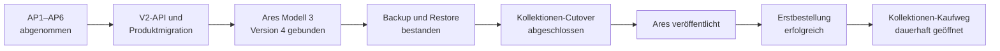

# Carmaja-Perlen Shop – finaler V1-Implementierungsplan mit V2-Ausbau

## Lokale Produkt-/Hashkorrektur – 11. November 2026

Basis ist main `f2ca27f18350914a1e63631739071dbf6074450d` nach PR #94.
Im isolierten Branch `codex/cart-product-consistency` ist der im lesenden
Preflight erkannte Modell-3-Lebenszyklusfehler lokal korrigiert: Verfügbarkeit,
serverseitige Produktversion und gespeicherter Quellhash müssen gemeinsam
fortgeschrieben werden. Modell-4-Verkaufsfreigabe und Bestandsregeln bleiben
unverändert. Eine abweichende veröffentlichte Fassung und ein unvollständiger
Legacy-Entwurf werden getrennt behandelt, nicht automatisch überschrieben.

Lokale Korrektur und künstliche Regression bestanden: PHP 8.4.23 mit 59
Produkt-API-Tests sowie Bootstrap-/Admin-/Browser-/Commerce-/Importprüfungen,
260 Node-Tests mit Shell-Mocks, Website-Lint, Testexport, Paketprüfung und
`git diff --check`. Vor der Korrektur wurde der gespeicherte Hashfehler
reproduziert. Reale Datenbereinigung und erneuter Produktionsnachweis bleiben offen.

Ursache, künstliche Regression und gesondert freizugebende Bereinigung:
[Produkt-/Hash-Bereinigungsplan](../website/docs/product-consistency-cleanup.md).
Keine heutige Serververbindung, keine Änderung realer Produktdaten und keine
Bereitstellung. Die folgenden älteren Statusabschnitte bleiben historische
Nachweise; diese lokale Korrektur ersetzt keine Produktionsgates oder Freigaben.

## Lokale Schema-Kompatibilitaetskorrektur – 11. November 2026

Die beim lesenden Produktions-Preflight erkannte historische AP6-Baseline
wird im isolierten Branch `codex/cart-historical-schema` jetzt eng
hashgebunden zusammen mit der vorhandenen Kollektionen-Vorwaertsmigration
akzeptiert. Bestehende Migrationseintraege und SQL-Dateien bleiben unveraendert.
Lokale kuenstliche Vertrags-/Importtests und der echte MySQL-Upgrade-/Restorelauf
sind bestanden: 67 praktische Pruefungen mit MySQL 8.0.46, alte Journalzeilen
unveraendert, historisches Upgrade strukturgleich zur Neuinstallation,
Backup/Restore, Crash, zehn parallele Importe und vollstaendiger Cleanup.
Gepruefter Korrekturcommit `50fcbbc122f4fa7bd8a95e03531a7a8f02ec933b`,
GitHub-Lauf [42980723713](https://github.com/Bumpers210/armband-rechner/actions/runs/42980723713).
Commit und Push erfolgten ausschliesslich auf `codex/cart-historical-schema`.
Kein Merge, IONOS-/Produktionszugriff oder Produktionsschritt.
Nachweise und Grenzen: [Produktionspaket Warenkorb](../website/docs/cart-production-package.md).
Alle Freigaben fuer Bereitstellung, Migration und Kaufstart bleiben unveraendert.

## Aktueller lokaler Produktionskandidat – 10. November 2026

Basis ist der zusammengefuehrte PR-92-Stand
`f7b5604c7b59312667598ad4c60d4e2a7770f4e6`. Die Warenkorb-Erweiterung hat
fuer ihren Umfang Vorrang vor den historischen Einzelkaufabschnitten unten.
Das lokale Paket wird isoliert auf `codex/cart-production-package` vorbereitet;
kein neuer Commit, Push, Merge, Serverzugriff oder Deployment ist erfolgt.

Geschlossen: fehlende V5-/Shop-v3-Produktionsdateiliste, Backupkorrekturen
`9b58d69`/`b4e9d3f`, separate Sperre neuer Checkouts, Versions-/Mengenvertrag,
technische textgleiche approved-Ueberfuehrung von Legal v7, leeres gesperrtes
Mengenmanifest und transaktionaler/idempotenter Importadapter. Historischer
Kollektionen-Apply und alter Sieben-Dateien-API-Deploy sind gesperrt.

Der neue Build-only-Workflow enthaelt keinerlei Produktionszugang.
Lokale Pruefkandidaten aus uncommittierter Arbeit sind ausdruecklich kein
freigegebener Release. Details, reproduzierbare Befehle, Nachweisgrenzen und
strikte Aktivierungsreihenfolge:
[Produktionspaket Warenkorb](../website/docs/cart-production-package.md).

Weiter offen: Review/Commit/CI/gesonderter main-Merge, praktischer isolierter
Nachweis der neuen Paket-/Importkombination, stabil signierte Produktions-App,
aktueller Produktions-Preflight, frisches verschluesseltes Backup mit Offsite-
und Restore-Nachweis, abgearbeitete Altzahlungen, bestaetigte reale Mengen,
kontrollierte Migration/Bereitstellung und ausdruecklicher Kaufstart mit
Erstbestellung/Beobachtung. Kein erneutes Oeffnen bereits bestaetigter
Rechtsfreigaben und keine Behauptung einer heutigen Produktionspruefung.
Keine erfundenen Ist-Arbeitsstunden oder neuen Kalenderzusagen.

## Neue Erweiterung vom 6. Oktober 2026: Mengenbestand und Warenkorb

Sicherheitsnachtrag 3. November 2026 (Abnahmebericht 3.83, PR #92): Die
16 moderaten npm-Entwicklungsbefunde wurden gezielt durch minimatch 11.0.4
und eine getestete Kompatibilitaetsfassade fuer die vorhandenen Lintwerkzeuge
geschlossen. Laufzeitabhaengigkeiten und Shopvertraege unveraendert. Beide
npm-Audits ohne Befund, 250 Node-Tests, Shell-Mocks, 224 PHP-Pruefungen,
Website-Lint und Testexport bestanden. CI prueft kuenftig auch den vollstaendigen
npm-Audit. Neuer Commit/Push nur im Warenkorbbranch; SHA-gebundene CI-Ergebnisse
im PR. Keine Merge-, Deployment-, Produktions- oder Cutoverfreigabe.

PC-Praxisabnahme 29. Oktober 2026 (Abnahmebericht 3.81/3.82): Kuenstlichen
Artikel mit zwei Bildern ueber die Browserverwaltung gespeichert, erneut
geladen, Preis/Mass und Bildreihenfolge geaendert sowie zweimal ausschliesslich
in die Testprojektion veroeffentlicht. 3200-Pixel-Grenze, Formatierung,
automatische Hinweise, serverseitige Versionen/Hash und Verkaufsfreigabe aus
bestanden; Bestand bleibt 0 / 0 / 0. Vorhandene Testprodukte, Bilder, Bestaende
und private Konfigurationen unveraendert verglichen. App-/Browserdienste
liefern identische Vertragsfelder; vollstaendige Sichtbarkeit auf dem Handy
anschliessend manuell durch die Betreiberin bestaetigt. Eigenen kuenstlichen
Artikel, seine Projektions-/Datei-/Auditdaten und temporaeren Prueferartefakte
eng begrenzt entfernt; Bestandsschutz und Cleanup unabhaengig nachgeprueft.
244 Node-Tests einschliesslich frischem Testexport, 59 PHP-API-, 37 PHP-Browser-
und 15 PHP-Katalogpruefungen sowie Website-Lint und `git diff --check` erneut
bestanden. Der gepruefte PC-Praxisumfang einschliesslich PC-zu-App-Sichtpruefung
ist damit testseitig abgenommen. Keine weitergehende Warenkorb-, Release-
oder Produktionsfreigabe; kein Commit, Push oder Deployment. Testdeploygate false.

Test-Ergaenzung 29. Oktober 2026: Perlenauswahl und Kalkulation am PC
(Abnahmebericht 3.78). Die angemeldete Artikelverwaltung liest ausschliesslich
dieselbe feste Preisliste wie die App. Material, Arbeitszeit, Stundenlohn,
sonstige Kosten und Aufschlag verwenden deren Dezimal-/Rundungsvertrag;
die Preisempfehlung wird auf 50 Cent aufgerundet. Uebernehmen fuellt nur
Perlen, Spacer und Preis im ungespeicherten Editor; kein automatisches
Speichern, Veroeffentlichen oder Aendern des Bestands. Die App speichert
Kalkulationseingaben bisher nur lokal: keine nachtraeglich behauptete
Synchronisierung interner Kalkulationen. Browser-Kalkulationen bleiben
ebenfalls nur im offenen Fenster; gemeinsame Artikelfelder nutzen weiterhin V5.
242 Node-Tests, PHP-API-/Browser-/Katalogtests, TypeScript, Lint und Testexport
bestanden. Testseitig eng begrenzt bereitgestellt; 18 aktive Katalogeintraege
ueber verifiziertes HTTPS geladen. Produkte, Bilder, Bestand, bestehende
Seiten und private Konfigurationen unveraendert verglichen. Das separat
freigegebene App-Testpasswort wurde erfolgreich durch die Betreiberin erneuert;
Reset-Hilfen bereinigt. Angemeldeter Lese-/Kalkulationsnachweis am 29.10.
bestanden (3.79): Katalog, Rechnung, Eingabegrenzen und Uebernahme in einen
ungespeicherten Artikel geprueft; reale Testprodukte nicht gespeichert oder
veraendert. 244 Node-Tests bestanden, Abbruch-/Bestaetigungspfad zusaetzlich
ausfuehrend getestet. Der zunaechst wegen einer Automationsstoerung offene
Live-Abbruch wurde anschliessend von der Betreiberin manuell geprueft und
mit unveraenderten Eingaben bestaetigt (3.80); keine nachtraeglich behauptete
automatisierte Live-Pruefung. Abschliessend erneut 244 Node-Tests, PHP 8.4.23
(59 API-Tests, 37 Browser- und 15 Katalogpruefungen sowie fuenf Syntaxpruefungen),
Website-Lint, TypeScript, Testexport mit 25 Seiten und `git diff --check`
bestanden. Privater Vergleich bestaetigt unveraenderte Testprodukte, Bilder,
Bestaende und Konfigurationen; Deployschalter weiterhin false.
Perlenauswahl und PC-Kalkulation einschliesslich Abbruchdialog sind damit
testseitig abgenommen. Keine pauschale schreibende PC-/App-E2E-, Warenkorb-,
Release- oder Produktionsfreigabe. Keine Commit-/Pushfreigabe.

Test-Erweiterung 28. Oktober 2026: Artikelverwaltung am PC (Abnahmebericht
3.77). Die neue Testseite `/artikelverwaltung/` verwendet dieselben privaten
V5-Produktdienste und Commerce-Bestandsvorgaenge wie die Beta-App, keinen
zweiten Produktdatenbestand. Artikel, formatierte Beschreibung, Bilder bis
3200 Pixel, Messwerte, Preis, Verkaufsfreigabe, Veroeffentlichen/Archivieren
und getrennte Bestandspflege sind implementiert. Bestehende App-Testbenutzer
werden mit separater kurzer Browser-Sitzung, CSRF und Versionskonflikten
abgesichert; Zugangsdaten und App-Geraetetokens bleiben unveraendert.
Lokale Regression und unangemeldete Test-HTTP-Sicherheitspruefungen bestanden.
Testseitige Bereitstellung ist rollbackfaehig, vorhandene Produkte, Bilder,
Bestaende und private Konfigurationen unveraendert verglichen. Der angemeldete
Browser-/App-Praxisnachweis war noch offen: Betreiberin kannte den bestehenden
Testzugang nicht mehr. Stand 28.10. ohne Passwortreset; Freigabe und technische
Bestaetigung des Resets am 29.10. siehe 3.78. Keine neue Gesamtfreigabe.
Der bestehende isolierte V5-Testumfang und seine Laufzeit bleiben bestehen;
Veroeffentlichen aktualisiert die Testprojektion, nicht automatisch den
statischen Websitebuild. Keine Produktions-, Commit- oder Pushfreigabe.

Aktueller Testnachweis 27. Oktober 2026 (Abnahmebericht 3.75):
Die dauerhafte Test-Shop-Anbindung ist auf ausdruecklichen Auftrag
bereitgestellt und verifiziert. Private MySQL-/TLS-, Stripe-Sandbox-/Test-Legal- und
Brevo-Testkonfiguration angebunden; Root-Shop-v3 und separater Testworker
einschliesslich echtem IONOS-UnixCron */5 bereit. Bestehende Produkt-/V5-
Routen und private Konfigurationen erhalten. 215 Node-Tests, 32 PHP-Suites,
Website-Lint und Testexport bestanden. Browser-Warenkorb 2+1 mit einmalig
270 Cent Versand und den drei freigegebenen Test-Zahlungsarten verifiziert.
Mehrere automatische Worker-Laeufe im Fuenf-Minuten-Takt, Lock und Lease
bestanden. Erster Browsercheckout von Stripe als unbezahlt abgelaufen
bestaetigt; signiertes Ablaufereignis verarbeitet, beide Reservierungen
ohne Bestandsabbuchung freigegeben. Anschliessender echter Sandbox-
Browserkauf ueber 77,70 EUR samt signiertem Webhook, bestaetigter Bestellung,
atomarer Mengenabbuchung 2+1, Replay-Schutz und beiden von Brevo als
zugestellt bestaetigten Bestellmails bestanden. Fehlenden Test-Bestellnummern-
Zaehler eng begrenzt initialisiert; keine bestehenden Nummern veraendert.
Eigene kuenstliche Kaufdaten, Produktseiten/Bilder und temporaere Pakete
bereinigt. Abschliessender Fuenf-Produkt-Export mit 194 Dateien hashgeprueft;
vorhandene Produkte, Bilder, Bestaende und private Konfigurationen unveraendert.
Test-Runtime, Sandbox-Webhook und echter Testcron bleiben fuer den
angeforderten Testbetrieb aktiv. Dieser integrierte Kartenzahlungs-E2E-
Nachweis wiederholt nicht die bereits separat bestandenen Klarna-/SEPA-
Pruefreihen und ist keine Produktions- oder Cutoverfreigabe. Testdeployschalter false;
kein Commit, Push, main-Merge oder Produktionszugriff.

Aktueller Nachtrag 26. Oktober 2026 (Abnahmebericht 3.74):
Die bisher offenen Aenderungen auf `codex/shop-inventory-cart` fuer einen
gemeinsamen lokalen Integrationscommit zusammengefuehrt: Websitegestaltung,
Zehnergrenze, Shop-/Admin-/Widerrufskorrekturen, knappe App-Rueckmeldung,
Abhaengigkeitsupdates, isolierte Nachweiswerkzeuge und Freigabedokumentation.
Erneut bestanden: 215 Node-Tests, 30 PHP-Suites mit PHP 8.4.23, PHP-Lint,
66 Android-Unit-Tests, Android-Lint ohne Fehler, Compose-Testkompilierung,
Website-Lint, kuenstlicher 24-Seiten-Testexport und Geheimwert-/Pfadpruefung.
npm-Audit meldet 0 Befunde. Lokaler assembleBeta-Lauf bleibt mangels stabiler
Signierung gesperrt; kein Ersatzschluessel, kein neuer installierbarer Build.
Naechstes Release-Gate: separat freigegebener Push/CI mit stabil signierter
Beta. Lokale Sicherung ist weder main-Integration noch Produktionsfreigabe.
Externe Freigabe v7 dokumentiert, technisch noch nicht aktiv ausgewaehlt;
Prueffassung und Hash unveraendert. Dauerhafte Testintegration und die
Produktions-/Backup-/Restore-/Mengenimport-/Cutovergates bleiben erforderlich.
Kein Serverzugriff oder Deployment, keine Testprodukt-/Konfigurationsaenderung.

Aktueller Nachtrag 25. Oktober 2026 (Abnahmebericht 3.73):
Die Betreiberin bestaetigt ausdruecklich die externe Prueferfreigabe der
endgueltigen Warenkorb-Rechtstextfassung samt Inhalts-Hash und der
Mehrpositions-, Vertragsabschluss-/AGB-, SEPA-, Teilwiderrufs-/Teilrefund-,
Versand-/Ruecksendekosten- und Datenschutzregeln. Zugeordnet zur aktuellen
Fassung `cmj-production-legal-2026-10-25-v7`, maximal zehn Armbaender insgesamt,
einmalig 2,70 EUR Versand. Exakter kanonisch validierter Hash und Herkunft
der Bestaetigung ohne vertrauliche Prueferdaten in
`website/docs/shop-cart-legal-review.md`. Externes fachliches Freigabegate
geschlossen; aeltere Ausstehend-Vermerke unten sind historische Zwischenstaende.
Prueffassung unveraendert erhalten: Der technische Status ist hashwirksam,
deshalb keine stille Umstellung auf approved. Vor einer spaeteren technischen
Auswahl sind Textgleichheit und neuer Bundle-Hash zu dieser Freigabe zu
dokumentieren. Aktive Produktionsauswahl und Testfassung bleiben unveraendert.
Nur Dokumentation geaendert; kein Serverzugriff, Commit, Push oder Deployment.
Naechster Schritt ist die kontrollierte Integrations-/Releasevorbereitung;
dauerhafte Runtime, Produktionsbackup/Restore, Bestaetigung tatsaechlicher
Mengen und separate Aktivierungs-/Cutoverfreigabe bleiben erforderlich.
Keine Produktions- oder Warenkorb-Gesamtfreigabe aus dieser Bestaetigung.

Aktueller Nachtrag 25. Oktober 2026 (Abnahmebericht 3.72):
Isolierter echter MySQL-8-/TLS-Grenznachweis in der zuvor leeren Restore-
Testdatenbank bestanden: 6+4 atomar reserviert, Versand einmalig 270 Cent,
neues Test-Legal-Bundle v4/hashgebunden; 6+5, alte uebergrosse Warenkoerbe
und Quotes ohne Mutation abgewiesen. Idempotenzbindung, gemeinsame Freigabe
bei nachweislich fehlender Session und ausdrueckliches Leeren bestanden.
Keine Provideraufrufe, Bestellung oder Mail; Source ausschliesslich lesend.
Alle eigenen Tabellen entfernt, Restore wieder leer, Testprodukte und
private Konfigurationen unveraendert. Private temporaere Teststufe und
lokale Paketdateien bereinigt. Node nun 215/215, Lint und Diff bestanden.
Root-Shop-Runtime weiterhin nicht dauerhaft aktiv; externe Freigabe des
Warenkorb-Rechtstextentwurfs v7 sowie kontrollierte dauerhafte Integration
bleiben offen. Kein Commit, Push, Produktionszugriff oder Cutover.

Aktueller Nachtrag 25. Oktober 2026 (Abnahmebericht 3.71):
Zehnergrenze in neuer Test-Rechtstextfassung v4 und Produktionsentwurf v7
versioniert; historische Fassungen/Hashes unveraendert, Produktionsentwurf
weiterhin awaiting_external_approval und nicht aktiv. 214 Node-Tests,
30 lokale PHP-8.4-Suites, Lint, Audit (0 Befunde), Shell-Mocks sowie
24-Seiten-Fixture- und 28-Seiten-Realtestkatalog-Build bestanden.
Websitehinweise und Testtexte auf der geschuetzten Testwebsite rollbackfaehig
bereitgestellt und im Browser geprueft. Alle fuenf Produkte, zehn
Originalbilder, V5-Teststufe, Test-API, private Konfigurationen und beide
Testdatenbanken unveraendert verglichen. Eigene temporaere Artefakte
bereinigt, private Ruecksicherung erhalten, Deployschalter false.
Keine dauerhafte Shop-Runtime bereitgestellt: Root-Kaufweg weiterhin
fail-closed; neue serverseitige Mengengrenze nur lokal getestet.
Kein erneuter dynamischer MySQL-/Provider-E2E-Nachweis behauptet.
Erneute Rechtsfreigabe und kontrollierte dauerhafte Integration bleiben
offen. Kein Commit, Push oder Produktionszugriff; keine Gesamt-/Cutoverfreigabe.

Aktueller Nachtrag 25. Oktober 2026 (Abnahmebericht 3.70):
Maximal zehn Armbaender insgesamt je Bestellung ausdruecklich freigegeben
und lokal implementiert. Summe aller Positionen, nicht zehn pro Produkt;
weiterhin einmalig 2,70 EUR Versand. Server prueft Warenkorbaenderung,
Checkout-Kontext und neue Reservierung. Alte uebergrosse Warenkoerbe
bleiben sichtbar/leerbar, aber nicht neu zahlbar; bestehende Zahlungen,
historische Bestellungen und Lagerbestaende bleiben unbeschraenkt erhalten.
Websitehinweis und Eingabe-/Checkoutgrenzen integriert. 30 PHP-8.4-Suites,
208 Node-Tests, Lint, Installation/Audit (0 Befunde) sowie kuenstlicher
23-Seiten-Testexport bestanden. PDO-Grenznachweis mit geskripteten Antworten,
kein erneuter echter MySQL-/Provider-/Browsernachweis. Keine App-, Schema-
oder Legal-Bundle-Aenderung. Versionierte Rechtstext-/Checkoutfassungen
einschliesslich der Zehnergrenze und externe Freigabe bleiben offen.
Kein Serverzugriff, Commit, Push oder Deployment; main, Produktion,
Testprodukte und private Konfigurationen unveraendert.

Aktueller Nachtrag 25. Oktober 2026 (Abnahmebericht 3.69):
Betreiberin bestaetigt maximal 10 fertig verpackte Armbaender je Maxibrief
fuer 2,70 EUR. Die fehlende praktische Packkapazitaet ist damit geklaert.
Der bestehende Warenkorbvertrag begrenzt weiterhin nur die Zahl unterschiedlicher
Positionen auf 100, nicht die gesamte Stueckzahl auf 10. Vorgeschlagener
naechster Schritt: maximal 10 Stueck je Bestellung ueber alle Positionen
summiert, bei unveraendert einmalig 2,70 EUR Versand. Diese neue Bestellgrenze
ist noch separat zu bestaetigen und technisch nachzuweisen; keine stillschweigende
Vertrags- oder Produktionsaenderung. Erneute Rechts-/Datenschutz-/Versandfreigabe
bleibt ausstehend. Ausschliesslich Dokumentation aktualisiert.

Aktueller Nachtrag 25. Oktober 2026 (Abnahmebericht 3.68):
Website-/Admin-Korrekturen und Dependency-Sicherheitsupdates gemeinsam als
privater, rollbackfaehiger Testwebsite-Preview bereitgestellt. Realer
Fuenf-Produkte-Testkatalog erhalten; nur bereits veroeffentlichte
Versions-/Hashmetadaten von HANDY-TEST im Buildkatalog aktualisiert,
keine Produkt- oder Bestandsmutation. 27-Seiten-Build, 30 Vorschaubilder,
Exportpruefung und Browserkontrolle von Startseite, Uebersicht, fuenf
Detailseiten, Warenkorb, Rueckkehrseiten, Admin-Fehlerrueckmeldung und
Informations-/Rechtsseiten bestanden. Bestehende Produkte, Bilder, private
Konfigurationen, Test-API und beide Testdatenbanken vor/nach Bereitstellung
und Cleanup unveraendert verglichen. Nur eigene temporaere Uebertragungs-
und Builddateien entfernt; private Ruecksicherung bleibt erhalten.
Deployschalter false. Root-Kaufweg bleibt ohne dauerhafte Runtime fail-closed;
keine erneuten dynamischen Zahlungs-/Rueckgabenachweise behauptet.
Noch keine dauerhafte Git-/Branchintegration und kein Commit/Push.
Erneute externe Rechts-/Datenschutzfreigabe und praktische Maxibrief-
Kapazitaet fuer Mengenbestellungen bleiben offen. Keine zusaetzliche
Mengenbegrenzung erfunden. main und Produktion unveraendert;
keine Gesamt-, Produktions- oder Cutoverfreigabe.

Aktueller Nachtrag 25. Oktober 2026 (Abnahmebericht 3.67):
Gezielte Website-Sicherheitsupdates lokal bestanden: Next.js und
eslint-config-next 16.4.3, sharp 0.35.5 sowie die betroffenen indirekten
Abhaengigkeiten aktualisiert. npm-Audit mit und ohne Entwicklungsabhaengigkeiten
jeweils 0 bekannte Befunde statt bisher 6. Saubere Installation,
201 Node-Tests inklusive 3 neuer Versions-/Lockdateitests, lokale Shellsuite,
Website-Lint, TypeScript und 23-Seiten-Testexport bestanden. 29 PHP-8.4-Suites
mit Lint bestanden; Android-Unit-Aufgabe erfolgreich/up-to-date (66 Tests),
lintDebug erneut erfolgreich. Plattformbedingte Ausnahmen und Umfang siehe
Abnahmebericht 3.67. Dependency-Gate lokal geschlossen, kein allgemeiner
Sicherheitsfreispruch. Erneute Rechtsfreigabe und kontrollierte Integration/
Bereitstellung der noch lokalen Websitekorrekturen bleiben offen.
Keine fachliche Aenderung, kein Serverzugriff, Commit, Push oder Deployment;
Testprodukte, private Konfigurationen, main und Produktion unveraendert.
Keine Gesamt-, Produktions- oder Cutoverfreigabe.

Aktueller Nachtrag 25. Oktober 2026 (Abnahmebericht 3.66):
Angemeldeter Admin-Browsernachweis abgeschlossen: Mehrpositionsbestellung,
Teilrefund-Anzeige, SEPA-processing ohne Bestellung, Schutz reservierter
Mengen, Zaehlkorrektur und ausdrueckliche positionsbezogene Wiedereinlagerung
mit Wiederholungssperre bestanden. Nur kuenstliche Restore-Fixtures; Source,
reale Testprodukte, Fotos, Bestandswerte und private Konfigurationen unveraendert.
Eigene Restore-Tabellen, Testendpunkte, private Stage und lokale Login-Datei
vollstaendig entfernt, Restore wieder leer; Test-Deployschalter false.
Fehlende Netzwerkfehlermeldung und veraltete Bestandsanzeige nach Rueckgabe
lokal korrigiert, sieben ausfuehrende Komponententests bestanden, noch kein
Deployment dieser Korrekturen. Abschlussregression mit 198 Node-Tests,
Shellsuite, Website-Lint, TypeScript, 23-Seiten-Testexport, PHP-8.4-Admin-
und Adaptertests sowie Diff-/Geheimwertpruefung bestanden. Dependency-Befunde, erneute Rechtsfreigabe
und kontrollierte Zusammenfuehrung der lokalen Websitekorrekturen bleiben
offen. Keine Gesamt-, Produktions- oder Cutoverfreigabe; kein Commit/Push.

Aktueller Nachtrag 25. Oktober 2026 (Abnahmebericht 3.65):
Integrierter Browser-Teilwiderruf auf ausschliesslich kuenstlichen Daten
der vorher leeren, getrennten Restore-Testdatenbank bestanden. Vorschau
ohne Einreichung/Mail, explizite Bestaetigung, Position 1/Menge 1 statt
gesamter Bestellung, ungeklärte Zuordnung und wiederholte Uebermenge mit
Reviewcases; keine automatische Wiedereinlagerung. Bestehende Source-
Produkte, Bestände, Fotos, private Konfigurationen sowie bisherige API-
und Website-Dateien unveraendert. Admin-Anmeldung mit falschem Passwort
abgewiesen; angemeldete UI-Aktionen warten auf einmalige manuelle
Test-Admin-Anmeldung. Fehlende Admin-Rueckmeldung bei Netzwerkfehler
als offener UI-Befund dokumentiert. Isolierte Vier-Stunden-Teststage und
deren Cleanup sind noch offen; dauerhafte Testkonfigurationen bleiben
erhalten. 191 Node-Tests, Website-Lint/Shellsuite, 24 PHP-Suites inklusive
neuem Adapterguard, Testexport und unveraenderte Android-Unit-/Lint-
Ergebnisse bestanden. Sechs Dependency-Befunde und erneute Rechtsfreigabe
bleiben offen. Keine Gesamt-, Produktions- oder Cutoverfreigabe.

Aktueller Nachtrag 25. Oktober 2026 (Abnahmebericht 3.64):
Freigabe-aus-Roundtrip in Beta.4 manuell bestaetigt und serverseitig lesend
bestanden: HANDY-TEST BILD3200 in Quelle/API/Projektion/Commerce einheitlich
Version 7, hashgleich, salesEnabled=false, kein Anfangsbestand. HANDY-TEST
weiterhin 3 / 0 / 3. Bildtest nach gesonderter Freigabe in die geschuetzte
Testwebsite aufgenommen; vier bestehende Katalogprodukte und ihre
Detailseiten erhalten. Echte 3200-Pixel-Grossansichten beider Bilder,
kleine Vorschauen, Bildwechsel, Tastatur/Fokus und Mobilansicht bestanden.
27-Seiten-Testexport, Website-Lint, 191 Node-Tests, Shellsuite und
28 PHP-Vertragspruefungen bestanden; private Daten, Konfigurationen und
beide Testdatenbanken unveraendert. Privater rollbackfaehiger Previewstand,
Test-Deployschalter false, Publisher weiterhin aus. Keine Produktions-
oder Cutoverfreigabe. Weitere integrierte Admin-/Widerrufs-UI-Nachweise,
Abhaengigkeitsbefunde und erneute Rechtsfreigabe bleiben offen.

Aktueller Nachtrag 21. Oktober 2026 (Abnahmebericht 3.62/3.63):
Verkaufsfreigabe-Fix inzwischen als Beta 1.4.0-beta.4 / Code 13 signiert
bereitgestellt, vom Nutzer installiert und in der isolierten V5-Test-API
bereitgestellt. Commit 0b60340e794e1e333c93b927b539738a88896342,
GitHub-Lauf 38797484661 erfolgreich; keine Produktionsbereitstellung.
Das abgelaufene Handystage-Zeitfenster auf ausdrueckliche Nutzerfreigabe um
sieben Tage ab Erneuerung verlaengert: bis 28. Oktober 2026, 12:12:55
Europe/Berlin (11:12:55 UTC). Nur private Ablaufmetadaten geaendert;
Produkte, Bilder, Bestandsdaten, Zugangsdateien, Runtime, beide Testdatenbanken
und Testwebsite unveraendert verglichen. Bootstrap-/HTTPS-/No-Store-Pruefung
bestanden; HANDY-TEST weiterhin 3 / 0 / 3. Naechstes Gate bleibt der manuelle
Freigabe-aus-Roundtrip mit Beta.4, anschliessend lesende Serverpruefung.
Keine Gesamtabnahme, keine Produktions- oder Cutoverfreigabe.

Historischer Nachtrag 15. Oktober 2026 (Abnahmebericht 3.61): HANDY-TEST BILD3200
manuell veroeffentlicht, Modell 4 / Version 3 mit gueltiger Hashbindung.
Beide Originalbilder 3200 x 1800 und 1800 x 3200 unveraendert; kein
Anfangsbestand, kein Inventar-/Reservierungsdatensatz, nicht kaufbar.
Bestehendes HANDY-TEST weiterhin 3 / 0 / 3. Datenbanken, Testwebsite,
Testprodukte und private Konfigurationen bei lesender Pruefung unveraendert.
Die Verkaufsfreigabe wurde entgegen der Nutzerabsicht automatisch true:
V5/App/Commerce hatten noch die automatische Kollektionen-Aktivierung.
Lokal korrigiert: explizite boolesche Freigabe durch Editor, PUT, Antwort,
Synchronisierung, Publish und Commerce-Projektion; Archivieren sperrt,
Wiederherstellen erteilt keine Freigabe. Modell 3 bleibt unveraendert.
Auch der lokale Modell-4-Publisher-Artefaktvertrag akzeptiert jetzt bewusst
nicht kaufbare Produkte, ohne Workflow-/Deploygates zu aendern.
24 PHP-Suites einschliesslich 59 API-Faellen und 28 neuen PDO-/Memory-
Vertragspruefungen, 66 Android-Unit-Tests, Lint, Debug-/AndroidTest-Build,
191 Node-Tests, Shellsuite und Testexport bestanden; nach letzter
Publisherkorrektur 20 gezielte Node-Tests/Lint erneut bestanden.
Kein echter MySQL-Schreibtest dieser Korrektur; Compose nur kompiliert.
Lokale Beta-Signierung fehlt weiterhin. Keine Versionsaenderung, kein
Commit/Push/Workflow/Deployment und keine Produktionsaenderung.
Naechstes Gate: abgestimmte signierte Beta/Test-API, manueller
Freigabe-aus-Roundtrip und danach reale Website-Bildkette. Statische
Testwebsite enthaelt den Bildtest noch nicht; Gesamtabnahme bleibt offen.

Abnahmestand 15. Oktober 2026: 21 relevante PHP-Suites, PHP-Lint,
187 Node-Tests mit Shellsuite, Website-Lint, kuenstlicher Testbuild/Export
sowie 59 Android-Unit-Tests und lintDebug erneut bestanden. Source/Restore
lesend mit MySQL 8/InnoDB/TLS bestaetigt; HANDY-TEST dabei 3 vorhanden,
0 reserviert, 3 verfuegbar (spaetere Bestandspflege siehe unten). Bestehende Testprodukte, private Konfigurationen
und Testwebsite-Dateien unveraendert geprueft; kein neuer Remote-Testdatensatz,
kein Deployment oder Produktionszugriff. Warenkorb bleibt bei fehlender
Runtime gesperrt; Admin-/Widerrufs-Sichtpruefung ersetzt nicht deren noch
offene angemeldete dynamische UI-Flows. Technischer Widerrufsfehlertext inzwischen
lokal korrigiert (3.60); bestehende Dependency-Auditbefunde bleiben offen.
Urspruengliche Regressionsdetails: Abnahmebericht 3.50.
Handy-Bestandsanzeige 3 / 0 / 3 und erneute manuelle Synchronisierung ohne
Bestandsmutation inzwischen bestanden (Abnahmebericht 3.51/3.52).
Entwurf jetzt Version 5 mit gueltigem kanonischem Hash, veroeffentlichte
Projektion/Commerce bewusst weiterhin Version 4. Inhalte und Originalbilder
unveraendert; genau eine Initialisierung 0 -> 3 erhalten. Anschliessende
manuelle Bestandserhoehung 3 -> 4 inzwischen bestanden (Abnahmebericht 3.53):
Anzeige 4 / 0 / 4, Inventarversion 2 und genau ein neuer `receive_stock`-Audit
mit Akteur-/Korrelations-/Idempotenzbindung. Produktfassungen, Bilder,
Website und private Konfigurationen unveraendert; keine Kaufdaten entstanden.
Manuelle Rueckkorrektur auf 3 ebenfalls bestanden (Abnahmebericht 3.54):
Anzeige 3 / 0 / 3, Inventarversion 3 und genau drei Audits fuer die gesamte
Folge 0 -> 3 -> 4 -> 3. Produktdaten, Bilder, private Konfigurationen und
Website unveraendert; Ausgangs-Testbestand mit erhaltener Auditgeschichte.
Erneutes Publizieren am 15. Oktober vom Nutzer gemeldet, aber serverseitig
nicht bestaetigt (Abnahmebericht 3.55): Handystage inzwischen abgelaufen,
Entwurf weiterhin Version 5, Projektion/Commerce Version 4. Bestand weiterhin
3 / 0 / 3, Inventarversion 3, genau drei Audits und eine Initialisierung.
Der unveraenderte Bestand allein ist kein erfolgreicher Publishnachweis.
Fehlende Rueckmeldung der App lokal korrigiert: Ladeindikator, bestaetigungs-
pflichtiger Erfolgs-/Fehlerdialog direkt in der Vorschau, kein stiller
Ruecksprung und kein erneutes Absenden nach bestaetigtem Erfolg. 63 Android-
Unit-Tests, lintDebug, Debug-/AndroidTest-Build und 11 relevante Node-
Vertragstests bestanden. Compose-Tests nur kompiliert, kein Emulator;
Handytests weiterhin ausschliesslich manuell. Lokales assembleBeta ohne stabile
Signierung korrekt gesperrt; anschliessend separat freigegebener GitHub-Build
38782340550 bestanden: Beta 1.4.0-beta.3 / Code 12 aus Commit
0f14956b0d1d6c9712a5936103928530acac6676, Testpaket/Test-API und stabiles
Zertifikat am APK geprueft. Produktionsversion unveraendert 1.4.0 / Code 8.
Installation vom Nutzer bestaetigt. Auf ausdruecklichen Auftrag nur die
Ablaufzeit der privaten V5-Handystage um 24 Stunden erneuert: bis
16. Oktober 2026, 20:18:36 Europe/Berlin (Abnahmebericht 3.56).
Produkte, Bilder, Authentifizierung, Runtime, Datenbankinhalte und Testwebsite
vor/nach der Erneuerung unveraendert verglichen. Bestand weiterhin 3 / 0 / 3.
HTTPS-/No-Store-/401-Guard bestanden. Anschliessende manuelle Veroeffentlichung
in Beta.3 mit sichtbarer Bestaetigung und unveraendertem Bestand bestanden
(Abnahmebericht 3.57): Entwurf, private oeffentliche Projektion und Commerce
jetzt einheitlich Produktversion 7 und kanonisch hashgleich. Weiterhin genau
eine Anfangsinitialisierung und drei Bestandsaudits, kein neuer Kaufdatensatz.
Keine Zugangsdaten neu angefordert.
In diesem Erneuerungsschritt kein Commit/Push/Workflowstart, Website-Deployment
oder produktiver Publish.
Erfolgstext auf Nutzerwunsch lokal auf `Veroeffentlichung bestaetigt` gekuerzt;
Fertig-Quittierung, laufende Aktionssperre und sichtbare Fehler bleiben erhalten.
63 Android-Unit-Tests, lintDebug, Debug-/AndroidTest-Build und 11 Node-Tests
bestanden; Compose-Pruefung mangels AVD nur kompiliert. Lokaler Beta-Build
ohne stabile Signierung weiterhin korrekt gesperrt; keine Ersatzsignierung.
Die Textkuerzung ist noch nicht in der installierten Beta.3 enthalten.
Manueller Bildtest-Upload inzwischen serverseitig bestanden (3.58): separater
Entwurf HANDY-TEST BILD3200, Produktmodell 4 / Version 1, zwei valide JPEGs
mit 3200 x 1800 und 1800 x 3200 Pixeln. Bildmetadaten und gespeicherte
Pruefsummen stimmen, kein GPS, kanonischer Produkthash und beide Hinweise
korrekt. Unveroeffentlicht, keine neue Commerce-Zeile oder Bestandsvormerkung;
HANDY-TEST weiterhin 3 / 0 / 3. Bestehende Daten und Website unveraendert.
58 PHP-API-Tests, 27 V5-Guardpruefungen, Warenkorb-Vertragssuite und
11 Node-Tests bestanden. Kleine Vorschauen und Wiederholbarkeit mit
kuenstlichen Bildern geprueft, keine privaten Originale lokal kopiert.
Manuelles erneutes Oeffnen/Anzeigen beider neuen Bilder vom Nutzer bestaetigt
(3.59); keine wiederholte Handypruefung erforderlich. In der anschliessenden
lokalen Browserpruefung funktionieren 3200-Pixel-Grossansicht, Bildwechsel,
Escape und Fokusrueckkehr mit ausschliesslich kuenstlichen Fotos (3.60).
Technische Rohfehler im Widerrufsformular lokal durch sichere verstaendliche
Meldungen ersetzt; bei unklarem Bestaetigungsausgang keine falsche Aussage
ueber einen fehlenden Eingang. Lokale Formularsimulation prueft Teilmengen,
explizite Bestaetigung auch bei fehlender Zuordnung, Netzwerkabbruch und
unlesbare API-Antwort. 190 Node-Tests, Lint, Shellsuite, drei relevante
PHP-Suites und kuenstlicher Testexport bestanden. Simulator/Fixtures bereinigt;
keine Servermutation oder Testwebsite-Aktivierung dieser lokalen Korrektur.
Websitekette der unveroeffentlichten Handyfotos, integrierte Admin-/Widerrufs-
UI-Flows und erneute Rechtsfreigabe stehen weiterhin aus;
die Erweiterung ist nicht vollstaendig abgenommen. Produkte,
Konfigurationen und Ruecksicherungen bleiben unveraendert erhalten.

Bildauftrag vom 15. Oktober 2026: isolierte V5-Test-API akzeptiert jetzt
JPEGs bis 3200 Pixel Kantenlaenge und 5 MiB; Test-App-Code nutzt dieselben
Upload-/Downloadgrenzen. Produktionsgrenzen bleiben 1600 Pixel/1 MiB.
Testwebsite erzeugt 240-/640-/1200-Pixel-Vorschauen, Original nur in der
geoeffneten Grossansicht. Vier Testprodukte, Originalfotos, private
Konfigurationen und Datenbankbestand unveraendert. HTTP-Upload/Download,
Fehlerfaelle, Preview-Rollback, PHP-/Node-/Android-Unit-/Lint-Pruefung bestanden
(Abnahmebericht 3.48). Neue Beta 1.4.0-beta.2 / Code 11 inzwischen ueber
den separat freigegebenen GitHub-Lauf 38727800430 erfolgreich signiert gebaut;
Testpaket, Test-API und stabiles Zertifikat geprueft (Abnahmebericht 3.49).
Der manuelle hochaufloesende Handy-Upload ist inzwischen technisch bestanden
(Abnahmebericht 3.58); weitere Anzeigepruefungen bleiben getrennte offene Gates.
Produktions-App unveraendert 1.4.0 / Code 8. In der aktuellen Abnahme keine
neuen Commits/Pushes/Workflowstarts. Hero-Mondornamente anschliessend auf
Nutzerwunsch nur ueber dem Startseitenfoto entfernt und testseitig geprueft;
uebrige Gestaltung erhalten.

Gestaltung am 15. Oktober 2026 nach Nutzerwahl vereinheitlicht:
„Edelsteinarmbaender mit Charakter.“ ersetzt den Ritual-Spruch. Frischer
Testexport fuer alle oeffentlichen Seiten inklusive Warenkorb, Rechtsseiten,
Abbruch/Fehler und Nicht-gefunden-Seite bereitgestellt; Rechtsinhalte,
Produkte und private Konfigurationen unveraendert. Desktop-/Mobilpruefung,
lokale Regression und hashgleicher Rueckbau bestanden (Abnahmebericht 3.47).
Nur Testvorschau; keine neue fachliche Freigabe und keine Produktionsaenderung.

Gestaltungsauftrag 15. Oktober 2026 auf der Testwebsite umgesetzt:
waermere Pflaume-/Creme-/Salbei-/Goldtoene, dezente Mond-/Sternornamente
und persoenlichere Start-/Katalogtexte. Beide Produkthinweise unveraendert
in kleiner Darstellung wie die Material-/Groessenangaben. Vier Testprodukte,
private Konfigurationen, Rechtstexte und Kaufsperren erhalten. 25 vorhandene
HTML-Seiten an einheitliche Gestaltung gebunden; Ruecksicherung praktisch
hashgleich geprueft. Lint, 181 Node-Tests, Shelltests, Testexport, PHP-Guards
und Desktop-/Mobil-Sichtpruefung bestanden (bestehende Auditmeldungen und
optionaler Shell-PHP-Skip siehe Abnahmebericht 3.46). Keine neue fachliche
Gesamtfreigabe, Produktionsaenderung oder Appaenderung. Spaeterer Rueckbau:
erst Gestaltungs-Overlay, dann HANDY-TEST-Websiteoverlay, dann V5-Stage.

Kontrollierte HANDY-TEST-Sichtpruefung 14. Oktober 2026 bereitgestellt:
Auf Nutzerauftrag temporaeres Katalogoverlay nur auf Testwebsite, aus
drei unveraenderten Produkten des tatsaechlichen Testwebsite-Basiscommits
plus der privaten V4-Projektion von HANDY-TEST gebaut. Startseite,
Uebersicht, eigene Detailseite/Bilder und benoetigte statische Assets
gezielt eingebunden; bestehende Detail-/Legal-/Authdateien unveraendert.
Rueckweg praktisch hashgleich bestanden, danach erneut aktiviert und
live Uebersicht, Messwerte, beide Hinweise und Bild-Grossansicht geprueft.
Nur statische Sichtpruefung, keine allgemeine Publisheraktivierung oder
automatische Aktualisierung nach kuenftigen Appaenderungen. Live-Preis /
Warenkorb weiter fail-closed; keine Zahlungs-Runtime bereitgestellt.
Anfangsbestand weiter 3 / 0 / 3, Version 1, keine Kaufdaten. Transfer-
artefakte bereinigt, private Ruecksicherung fuer weitere manuelle Tests
erhalten. Vor Stage-Cleanup erst Websiteoverlay rueckbauen; neuer Guard
verhindert vorzeitiges Loeschen des Rueckwegs. Testdeploy-Gate false,
kein Commit/Push/Merge oder Produktionszugriff. Details 3.45; offene
Handy-Bestands- und UI-/Rechtsgates bleiben bestehen.

Manuelle V5-Testveroeffentlichung 14. Oktober 2026 bestanden:
HANDY-TEST in eigener isolierter Stage published, Produktversion 4 und
kanonischer Hash zwischen autoritativer Quelle, Commerce und privater
oeffentlicher V4-Projektion konsistent. Preis, Messwerte, zwei JPEGs und
beide Hinweise erhalten; Projektion exakt {version, products}, ohne
stock/vintedUrl. Anfangsmenge 3 angewendet: vorhanden 3, reserviert 0,
verfuegbar 3, Inventarversion 1; genau ein Audit 0 -> 3 mit initial_count
und gebundenem Idempotenz-/Korrelationsbezug. Keine Kaeufe, Reservierungen,
Bestellungen oder Mails. Privater lokaler Publisher, keine Testwebsite- /
GitHub- / Produktionsveroeffentlichung; bisherige Testprodukte und
Masterkonfigurationen unveraendert. Naechster manueller Schritt nur
Bestand neu laden und Anzeige 3 / 0 / 3 am Handy bestaetigen.
Erneute Synchronisierung/Bestandspflege am Handy und Gesamtfreigabe
weiterhin offen. Details 3.44; kein Produktions- oder Cutovergate geoeffnet.

Manuelle V5-Anfangsbestandsvormerkung 14. Oktober 2026 bestanden:
Nutzerbestaetigung und getrennte lesende Serverkontrolle ergeben genau
eine Vormerkung fuer HANDY-TEST mit targetOnHand=3, noch nicht angewendet.
Erneute Synchronisierung liefert serverseitige Produktversion 2 bei
unveraenderten 28,00 EUR, 18 cm, 8 mm und beiden Hinweisen; Hash gueltig,
beide hochgeladenen JPEGs lesend validiert. Entwurf unveroeffentlicht,
noch kein Commerce-Produkt/Bestand oder Kaufvorgang, Restore leer.
Bisherige Testprodukte, Masterkonfigurationen und Routing unveraendert.
Naechster manueller Schritt nur kuenstliche Veroeffentlichung in eigener
V5-Stage, nicht auf der Testwebsite oder in Produktion. Einmalige
Anwendung der Vormerkung und Publisher-Roundtrip erst danach pruefen.
Details 3.43; keine Gesamt-, Produktions- oder Cutoverfreigabe.

Manueller V5-Entwurf-Roundtrip 14. Oktober 2026 bestanden: Nutzer meldet
Synchronisierung und Werterhalt beim erneuten Oeffnen; getrennte lesende
Serverkontrolle bestaetigt genau einen kuenstlichen HANDY-TEST-Entwurf,
Produktmodell 4, serverseitige Produktversion 1, gueltigen kanonischen Hash,
28,00 EUR, 18 cm, 8 mm und beide festen Hinweise. Zwei Bildzuordnungen
vorhanden; noch keine gesonderte Bild-/Publisher-Abnahme am Handy.
Entwurf unveroeffentlicht, salesEnabled=false, keine Commerce-Nutzdaten,
Restore leer. Bisherige Testprodukte, private Masterkonfigurationen und
Routing unveraendert. Naechster manueller Schritt: Anfangsmenge 3 nur
vormerken; noch nicht veroeffentlichen oder kaufbar machen. Details 3.42;
Publisher-/Bestands-Roundtrip und Gesamtfreigabe weiterhin offen.

Manueller V5-Login 14. Oktober 2026 bestanden: Nutzerbestaetigung durch
frischen aktiven Stage-Geraetetoken und authentifizierten Lesezugriff
serverseitig belegt. Keine Geraete-/Zugangsdaten im Repository. Eigene
Stage noch ohne Produkte/Commerce-Nutzdaten, Restore leer; bestehende
Testprodukte und Masterkonfigurationen erhalten. Als naechstes nur
HANDY-TEST am Handy speichern/synchronisieren und erneut oeffnen; noch
keine Veroeffentlichung oder Bestandsaktion. Kuenftige temporaere Test-
zugangsfenster mit leicht abtippbarem Benutzernamen und lesbarer zufaelliger
Passphrase, unveraenderter privater Speicherung, Argon2id und Befristung.
Aktuellen Zugang nicht drehen oder erneut abfragen. Details 3.41;
weiterhin keine Gesamt-, Produktions- oder Cutoverfreigabe.

V5-Handytest-Vorbereitung 14. Oktober 2026: Eigene private kuenstliche
Stage und nur temporaeres /v5-Routing bereit, bisherige Produkte,
Konfigurationen, V1-/V2-/V3-/V4-Wege und Testwebsite erhalten. Eigener
Testzugang mit Argon2id, private Runtime und Masterkonfigurationen 0600;
aktive TLS-Sitzungen auf getrennten leeren MySQL-8-/InnoDB-Zielen geprueft.
Echter HTTPS-Rundlauf mit Version/Hash/Hinweisen, Bild-Upload, privater
V4-Projektion, einmaligem Anfangsbestand, Inventaraudit, Replay und
Versionskonflikten bestanden. Vollstaendiger Routing-/Schema-/Stage-
Rueckbau praktisch bestanden, danach frische Bereitstellung und erneuter
kompletter Rundlauf bestanden. Automatische Probe entfernt; Source nur
mit Migrationsjournal, Restore leer. Keine Checkout-/Mail-/Workeraktionen.
Stage fuer manuellen Handytest bis 15. Oktober 19:38:38 Europe/Berlin
erhalten; Testzugang lokal ACL-/DPAPI-geschuetzt im Anzeigefenster,
Klartexttransfer und lokaler Transferordner entfernt. Nach manuellen
Tests eigene Stage und Zugangskopie vollstaendig bereinigen, bisherige
Testprodukte und Masterkonfigurationen erhalten. 27 neue Guards,
57 API-/13 Bootstrap-/29 Warenkorbfaelle und fuenf Node-Vertraege bestanden.
Keine Appaenderung, kein USB/ADB, Commit/Push/Merge, Produktionszugriff
oder Produktionsdeploy. API fuer manuellen Test bereit, Handy-Server-
Roundtrip und dynamische Admin-/Widerrufsflows weiter offen. Details 3.40.

Verbindlicher Handy-Pruefmodus 14. Oktober 2026: Nutzer fuehrt alle
Handypruefungen manuell durch. Keine USB-/ADB-Verbindung, automatische
Handyinstallation oder Instrumentierung als Voraussetzung anfordern;
fruehere USB-Aufforderungen sind ueberholt. Lokale Sichtpruefung 3.38
bleibt bestanden. Weitere App/API/Publisher-/Bestands-Roundtrips erst nach
bereitgestellter isolierter V5-Test-Runtime, mit kurzen manuellen Schritten
und getrennten serverseitigen Kontrollen. Keine weitere Abnahme behauptet.
Testprodukte und private Konfigurationen erhalten; keine Produktions-
oder Cutoverfreigabe. Details: Abnahmebericht 3.39.

Handynachtrag 14. Oktober 2026: Nutzer bestaetigt lokale Beta-Version
1.4.0-beta.1, Test-API-Anzeige, Werterhalt nach erneutem Oeffnen,
Eingabevalidierung, Bestandsfeld, beide Hinweise und problemlose Bedienung.
Diese manuelle lokale Sichtpruefung ist bestanden, kein Server-Roundtrip
oder Gesamtnachweis. 57 Product-API- und 13 Bootstrap-Tests erneut bestanden.
ADB weiterhin ohne verbundenes Geraet; diagnostischer Dienst beendet.
Naechster menschlicher Schritt fuer automatisierte Geraetepruefungen:
entsperrtes Android-Testhandy per USB anschliessen. Isolierte V5-Runtime
und dynamische Admin-/Widerrufsflows weiterhin offen. Testprodukte und
private Konfigurationen erhalten; keine Server-/Produktionsaenderung.
Details 3.38; keine Gesamt-, Deployment- oder Cutoverfreigabe.

UI-/Geraetenachtrag 14. Oktober 2026: Browser-Pflichtfelder fuer Admin und
Widerruf sowie Warenkorb-Fail-closed ohne Checkout nach Runtime-Cleanup
geprueft; keine pauschale dynamische UI-Abnahme. Separate statische
Mail-Vorschau noch historisch (Einzelprodukt, 4,90 EUR), nicht der bereits
bestandene Warenkorb-Mailnachweis. Beta-APK 1.4.0-beta.1 / Code 10,
Testpaket, stabile Signatur und Test-/Produktions-API-Trennung erneut
bestaetigt. Kein Android-Geraet/AVD verfuegbar; echte Geraetepruefung offen.
Permanente Test-API derzeit ohne V5, V5-/Warenkorbgates false; weitere
Flows benoetigen isolierte kuenstliche Runtime, bestehende Produkte bleiben
unveraendert. PHP-/Node-Vertraege bestanden; keine neue Gesamtregression.
Nur Dokumentation, keine Server-/Produktionsaenderung. Naechste einzelne
Nutzereingabe: Android-Testhandy per USB anschliessen. Details 3.37.
Keine Gesamt-, Deployment- oder Cutoverfreigabe.

Abschlussnachtrag 14. Oktober 2026: Echter SEPA-FEHLER nach der
Checkoutzeitgrenze bestanden. Processing um 18:29:05 Europe/Berlin;
Zeitgrenze 18:30:42, weiterhin processing um 18:30:44 mit beiden Mengen
2/1 reserviert, Bestand 30/30 und keiner Bestellung/Mail. Echter gebundener
async_payment_failed erst 18:35:10; danach failed/verified, beide
Reservierungen released, Bestand unveraendert und keine Bestellung,
Sendung, Mail oder Reviewcase. Deduplizierung und umgekehrter doppelter
Replay unveraendert. Observer beendet, eigener Webhook/Endpunkt/Stage
und lokale Transfers vollstaendig bereinigt, beide Testdatenbanken leer.
Bestehende Testprodukte/Runtime/API/Testwebsite unveraendert; private
Datenbank-/Stripe-Konfigurationen hashgleich mit 0600 erhalten. Kein
Cron, Commit/Push/Deployment oder Produktionszugriff. Gemeinsam mit 3.31
sind beide echten SEPA-Endzustaende nach dem Checkoutzeitpunkt nachgewiesen.
Weitere UI-/Geraete-/Rechtsgates offen; keine Gesamt- oder Cutoverfreigabe.
Details: Abnahmebericht 3.36. Nachfolgende Vorlaufnachtraege sind historische
Zwischenstaende und ersetzen dieses aktuelle Ergebnis nicht.

Neuer begleiteter Versuch 14. Oktober 2026: Vorheriger Fehler-Retest
unbezahlt abgelaufen, ohne Einreichung; sicher verarbeitet und vollstaendig
bereinigt, beide Testdatenbanken leer. Erfolgsnachweis 3.31 unveraendert.
Nach Nutzerhinweis zur laengeren Verfuegbarkeit eigene neue kuenstliche
Stage vorbereitet, genau ein Checkout HTTP 201, unveraenderte 30 Minuten.
Klickfenster ab 18:28:42 Europe/Berlin, Zeitgrenze 18:30:42. Privater
failure-Observer laeuft und neuer Zahlungstab ist vorbereitet/ausgewaehlt.
Noch keine Einreichung, Fehlergate offen; eigener Cleanup danach erforderlich.
Masterkonfigurationen und bestehende Testprodukte erhalten, keine
Produktionsaenderung, Gesamt- oder Cutoverfreigabe. Details: Abnahmebericht 3.35.

Autonome Wiederholung 14. Oktober 2026: Neuer isolierter SEPA-Fehlerfall
nach lesendem Leerheits-/TLS-Vorflug vorbereitet; Konfigurationen und
Testprodukte unveraendert erhalten. Erster HTTP-Start ohne Saga/Zahlung
fehlgeschlagen, nach gezielter Diagnose genau ein neuer Start HTTP 201;
Ursache des ersten Fehlers nicht belegt. Privater failure-Observer laeuft,
eigener Zahlungstab vorbereitet/ausgewaehlt. Klickaufforderung erst 17:00:43
Europe/Berlin, unveraenderter Ablauf 17:02:43. 79/29/57 PHP-Testassertions,
fuenf Stripe-PHP-Tests und git diff --check bestanden. Persoenlicher
Zahlungsklick erforderlich, Fehlergate noch offen. Eigener vollstaendiger
Cleanup nach Test; keine Produktionsaenderung oder Gesamtabnahme.
Details: Abnahmebericht 3.34.

Wiederaufnahme 14. Oktober 2026: Bei eingegangener Sichtbestaetigung war
die vorbereitete Fehlerfall-Session bereits expired/unpaid. Keine SEPA-
Einreichung oder asynchrones Fehlerereignis, Fehlergate weiterhin offen;
bestandener Erfolgsnachweis 3.31 unveraendert. Unbezahlter Ablauf korrekt:
Bestand 30/30, Reservierungen freigegeben, keine Bestellung/Mail, Worker-
Wiederanlauf unveraendert. Observer beendet und eigener vollstaendiger
Cleanup nachgewiesen; beide Testdatenbanken leer. Testprodukte, Runtime/API
und Testwebsite erhalten, private Datenbank-/Stripe-Konfigurationen
hashgleich mit 0600 erhalten. Vor neuer Session die Verfuegbarkeit fuer
die begleitete Zeitpruefung abstimmen. Keine Produktionsaenderung oder
Gesamtabnahme. Details: Abnahmebericht 3.33.

Fortsetzung 14. Oktober 2026: Getrennter echter SEPA-FEHLER nach der
Zeitgrenze in eigener kuenstlicher Stage vorbereitet. Erfolgsnachweis
aus 3.31 bleibt bestanden; Fehlergate noch offen. Privater Observer
erfasst processing nach Ablauf und ausschliesslich echte gebundene
asynchrone Fehler. 79/29/57 PHP-Testassertions und fuenf Stripe-PHP-Tests
bestanden; keine Shopfachlogikaenderung. Zahlungstab vorbereitet und in
Chrome ausgewaehlt, menschliche Sichtbestaetigung vor Einreichung angefragt.
Testprodukte und private Konfigurationen unveraendert erhalten;
Testdaten-/Artefakt-Cleanup nach Abschluss vorgeschrieben. Keine
Produktionsaenderung, Gesamt-, Deployment- oder Cutoverfreigabe.
Details: Abnahmebericht 3.32.

Abschlussnachtrag 14. Oktober 2026: Echter SEPA-Erfolg NACH dem
Checkoutzeitpunkt bestanden. Um 13:50:26 Europe/Berlin weiterhin processing,
beide Mengen 2/1 reserviert, Bestand 30/30, keine Bestellung oder Mail;
Checkoutzeitpunkt 13:50:24. Echter asynchroner Stripe-Erfolg erst 13:54:24,
danach genau eine Bestellung mit zwei Positionen und Bestand 28/29,
zwei Verkaufsaudits, Reservierungen gemeinsam converted. Zustimmung,
Legal-/Hinweis-/Versandsnapshots und umgekehrter doppelter Replay geprueft.
Bestellmail nur vorgemerkt, kein neuer Brevo-Versand in diesem Grenzfall.
Observer beendet; Stage, eigener Webhook/Endpunkt und lokale Transfers
vollstaendig bereinigt; beide Testdatenbanken leer. Bestehende Testprodukte,
Runtime/API und Testwebsite erhalten; Datenbank-/Stripe-Konfigurationen
hashgleich mit 0600 erhalten. 44/29/57 PHP-Testassertions, fuenf Stripe-
PHP-Tests und git diff --check bestanden. Kein Commit/Push/Deployment oder
Produktionszugriff. Der echte SEPA-FEHLER nach demselben Zeitpunkt bleibt
getrennt offen, ebenso UI-/Geraete-/Rechtsgates. Keine Gesamtfreigabe.
Details: Abnahmebericht 3.31. Nachfolgende Vorlaufnachtraege dokumentieren
historische Zwischenstaende; sie ersetzen dieses aktuelle Ergebnis nicht.

Neue Sichtbestaetigung 14. Oktober 2026: Zahlungsformular einer eigenen
kuenstlichen Sandboxstage vorbereitet; vor zeitkritischer Einreichung
seine tatsaechliche Sichtbarkeit durch den Nutzer bestaetigen lassen.
Observer an lokalen 1.800-Sekunden-Checkout und identischen Providerablauf
gebunden (Stripe-Objekt wurde eine Sekunde spaeter angelegt). 44 PHP-
Observerassertions bestanden, keine Fachlogikaenderung. Noch keine Zahlung
oder neue Abnahme. Temporaere Stage nach Testabschluss bereinigen,
Masterkonfigurationen und reale Testprodukte erhalten. Produktionsgates
unveraendert. Details: Abnahmebericht 3.30.

Ergebnis der begleiteten Wiederholung 14. Oktober 2026: Keine persoenliche
Zahlungseinreichung serverseitig beobachtet; Stripe bestaetigte expired/unpaid.
Keine processing-Probe und kein asynchroner Erfolg. Der reale SEPA-Endzustand
nach dem 30-Minuten-Zeitpunkt bleibt offen; keine pauschale Abnahme.
Die bestaetigte Ablaufverarbeitung gab beide Mengen sicher frei, ohne
Bestandsabbuchung, Bestellung oder Mail; Wiederanlauf unveraendert.
Beobachter beendet; eigene Stage, Webhook, Endpunkt und lokale Transferdateien
vollstaendig entfernt, beide Testdatenbanken leer. Bestehende Produkt-/Runtime-/
API-Dateien hashgleich und Testwebsite unveraendert. Datenbank- und Stripe-
Konfigurationen unveraendert mit 0600 erhalten. Keine Produktionsaenderung,
kein Commit/Push/Deployment/Cutover. Details: Abnahmebericht 3.29.

Begleitete Wiederholung 14. Oktober 2026: Neue private kuenstliche Teststage
mit erhaltenen Datenbank-/Stripe-Konfigurationen. Zeitlich begrenzter privater
SEPA-Testbeobachter erfasst die echten Mengen-/Payment-Invarianten automatisch;
35 neue PHP-Testassertions und bestehende relevante PHP-Guards bestanden.
Session endet um 12:43:07 Europe/Berlin, Aufforderung zur persoenlichen
Bestaetigung erst ab 12:41:07. Zwischenstand, Ergebnis siehe 3.29; keine
kuenstliche Zeit-/Statusmutation. Cleanup und Konfigurationsaufbewahrung
nach bestehendem Vertrag; alle Produktionsgates unveraendert. Details 3.28.

Fortsetzung 14. Oktober 2026: Gezielter SEPA-Zeitgrenzfall nicht erreicht.
Stripe meldet fuer die vorbereitete Session expired/unpaid; alleiniger
echter Ablaufwebhook um 11:41:25 Europe/Berlin, kein Zahlungsabschluss und
kein asynchroner Erfolg. Mehrdeutige Browseranzeige nicht als Erfolg werten;
Ursache der nicht abgeschlossenen Einreichung nicht nachgewiesen.
Unbezahlter bestaetigter Ablauf korrekt verarbeitet: beide Mengen gemeinsam
freigegeben, Bestand 30/30 unveraendert, null Bestellungen/Mails/Verkaufs-
abbuchungen, Replay unveraendert. Gewuenschter SEPA-Endzustand nach diesem
Zeitpunkt bleibt offen. Vollstaendiger Testdaten-/Artefakt-Cleanup, beide
Testdatenbanken leer. Private Datenbank- und Stripe-Konfigurationen hashgleich
mit 0600 erhalten; bestehende Testprodukte/Runtime/API unveraendert,
Testwebsite nicht veraendert. Details: Abnahmebericht 3.26/3.27.
Keine Gesamt-, Produktions- oder Cutoverfreigabe.

Aktueller Nachtrag 14. Oktober 2026: Originaler Browser-SEPA-Checkout bis
Webhooks, Worker, Bestellung und Bestellmail bestanden. Zwei kuenstliche
Positionen mit Mengen 2/1, 7.770 Cent einschliesslich einmalig 270 Cent Versand.
Processing hielt alle Mengen ohne Bestellung/Mail; echter Stripe-Erfolg
finalisierte genau eine Bestellung, Bestand 30/30 -> 28/29. Browseranzeige
wechselte zu bestaetigt. Legal-/Hinweissnapshots, zwei Bestandsaudits,
Replay-/Reihenfolgesicherheit und Brevo-Zustellung beider Originalmails geprueft.
Der Erfolg trat VOR dem Checkoutzeitpunkt ein; SEPA-Endzustand erst danach
bleibt als eigener Grenzfall offen. PHP-8.4, 181 Node-Tests, Shell, Test-Lint
und Testbuild/Export aus 3.23 bleiben bestanden; keine erneute Vollregression
oder Umdeklaration anderer Gates. Vollstaendiger Cleanup, Website/API hashgleich
zurueckgesetzt, drei bisherige Testprodukte unveraendert; private Datenbank-
Konfiguration hashgleich mit 0600 erhalten. Weitere UI-, Geraete- und
Rechtsgates offen; keine Gesamtabnahme, keine Produktionsfreigabe.
Details: Abnahmebericht 3.23/3.24.

Stripe-Nachtrag 14. Oktober 2026: Private Sandboxkonfiguration mit Modus 0600,
Testschluessel, Webhook-Aufbewahrungsschluesselvertrag und echter lesender
Stripe-Testverbindung (livemode=false) bestaetigt. Datenbank-Konfiguration
weiterhin vorhanden und zu erhalten. Keine Zahlung, Stage-, Datenbank- oder
Routingmutation. Vor weiterer Test-Site-Initialisierung fehlt die explizite
Brevo-Testkonfiguration mit eigener bestaetigter Empfaengeradresse; diese
wird als naechster einzelner Einzelschritt interaktiv erfasst. Keine Suche
in bestehenden Secret-Stores und keine Produktionsaenderung.
Details: Abnahmebericht 3.22.

Vorflugnachtrag 14. Oktober 2026: Private Warenkorb-Testdatenbank-Konfiguration
erneut bereitgestellt und mit Modus 0600 geprueft. Source und Restore sind
getrennt, beide leer, MySQL 8.0.36 mit InnoDB und aktiver TLSv1.3-Sitzung.
CA-/Hostidentitaetsnachweis weiterhin fehlend und als Test-Restrisiko akzeptiert.
Datei bleibt gemaess neuem Cleanup-Vertrag erhalten. Keine Datenbankmutation
oder Wiederholung bestandener MySQL-Pruefreihen. Naechster einzelner Schritt:
fehlende Stripe-Sandboxkonfiguration geschuetzt erfassen, danach offene
SEPA-/Browsernachweise fortsetzen. Keine Produktions-/Cutoverfreigabe.
Details: Abnahmebericht 3.21.

Cleanup-Vertrag ab 14. Oktober 2026: Die private Datei
/home/www/carmaja-private-test/shop-cart-test.json wird nach ausdruecklicher
Nutzerfreigabe zwischen Testlaeufen mit Modus 0600 ausserhalb aller Webroots
unveraendert erhalten und wiederverwendet. Keine automatische Ueberschreibung,
Secret-Ausgabe oder Versionierung. Temporaere Stages, Runtimekopien,
Testdaten/-tabellen, Endpunkte, eigene Cronjobs und Transferartefakte weiterhin
vollstaendig entfernen. Nach ergaenzender ausdruecklicher Nutzeranweisung
bleibt auch /home/www/carmaja-private-test/shop-cart-stripe-test.json zwischen
den Warenkorb-Testlaeufen mit 0600 erhalten und wird nicht routinemaessig
geloescht oder erneut abgefragt. Keine automatische Ueberschreibung;
vor Nutzung Sandbox-/Schluesselvertrag und lesende Testverbindung pruefen.
Brevo-/Produktionskonfigurationen und dauerhaft aktive Shop-Runtimes sind
von dieser Aufbewahrungsfreigabe nicht umfasst. Der fruehere fehlende
Datenbankstand wurde in 3.21 behoben; die beim damaligen Cleanup entfernte
Stripe-Datei ist einmalig erneut sicher bereitzustellen. Weitere Nutzung
nur nach lesendem Identitaets-/TLS-/Sandboxvorflug. Details: Abnahmebericht
3.20/3.25. Keine Produktions- oder Cutoverfreigabe.

Aktueller Stand 14. Oktober 2026: Der Cron-Blocker aus der Pruefreihe vom
11. Oktober ist ausdruecklich durch Nutzerentscheidung geschlossen. Der
fehlende technische Zwei-Lauf-Nachweis bleibt als historischer Befund bestehen;
keine Umdeklaration zu technisch bestanden und keine weitere Supportaktion
als Voraussetzung. Andere SEPA-/Browser-/UI-, Geraete- und Rechtsgates bleiben
offen. Produktion und Cutover weiterhin nicht freigegeben. Der letzte Cleanup
bleibt erhalten; fuer die weitere isolierte Testabnahme fehlen die expliziten
privaten Testkonfigurationen und werden einzeln per Eingabeskript erfasst.
Keine Suche in bestehenden Secret-Stores. Fuenf gezielte Node-Tests,
PHP-CSRF-/Testadapter-Pruefungen und Eingabeskript-Selbsttest erneut bestanden.
Details: Abnahmebericht 3.19.

Aktueller Nachtrag 11. Oktober 2026: Historische Einzelbestellungen wurden
kuenstlich in der getrennten Restore-Testdatenbank verlustfrei migriert;
Wiederholung idempotent, Restoreziel danach leer. Echte Quote-/Checkouttoken-
Ablaufpruefungen und Browserabbruch bestanden. Nach bestaetigtem Stripeablauf
werden Mengen freigegeben, ohne zweite Bestellung. Die Warenkorb-Rueckkehr-
anzeige fuer canceled/expired ist korrigiert und live geprueft; SEPA-processing
bleibt vorrangig. 181 Node-Tests, Shell, Test-Lint, Testbuild/Export und 18
PHP-8.4-Suites bestanden. Der temporaere IONOS-UnixCron wurde angelegt, aber
sechs faellige Termine bis 19:40:58 UTC hinterliessen keine automatischen
Start-/Laufmarker oder Leasezeitpunkte. Der Cronnachweis ist nicht bestanden;
Ursache ungeklärt, IONOS-seitiger Ausfuehrungsnachweis erforderlich. Direktlaeufe
werden nicht als Cronnachweis gewertet. Anschliessender Cleanup vollstaendig
bestanden: Cron, Webhook, oeffentliche/private Teststage, kuenstliche Daten,
private Testkonfigurationen und lokaler Tempordner entfernt; beide Testdatenbanken
wieder leer. Website und API hashgleich zurueckgesetzt, drei vorhandene
Testprodukte unveraendert sichtbar. Keine Gesamtabnahme, kein Commit/Push und
keine Produktionsaenderung. Details: Abnahmebericht 3.17/3.18.

Nachtrag 11. Oktober 2026: Mehrtab-CSRF im isolierten Warenkorbrouter korrigiert;
V3-Tokens bleiben sitzungsgebunden, zweistundenbegrenzt und MAC-geprueft,
ohne gegenseitige Invalidierung durch Kontextabrufe. Legacy/Produktion
unveraendert. Veralteter Warenkorb sperrt nun seinen Checkout bis zum Neuladen.
Echter Browser-Mehrtab- und API-Ausfallnachweis sowie HTTP-Sicherheitsreihe,
Teilwiderruf, Mengen-Prueffaelle, drei zugestellte Eingangsbestätigungen und
Admin-HTTP-Nachweis bestanden. Kuenstlicher aktueller Testexport besteht;
selektive Flowseiten sind nur temporaer rollbackgebunden aktiviert.
Keine Gesamtabnahme: dynamische Browserstatus-/Checkout-Token-/UI-Faelle,
echter UnixCron und abschliessender Cleanup bleiben offen. IONOS verlangt
erneuten interaktiven Login. Bestehende npm-Abhaengigkeitswarnungen werden
nicht durch ungefragte Updates oder eine pauschale Entwarnung verdeckt.
Details und verbleibende Gates: website/docs/shop-cart-acceptance.md, 3.16.

Nachweisstand 11. Oktober 2026: Der originale Chrome-Warenkorb mit zwei
kuenstlichen Positionen und Mengen 2/1 ist bis zur echten Stripe-
Sandboxkartenzahlung, signiertem Webhook, atomarer Bestellung und
Bestandsabbuchung sowie zugestellter Original-Bestellmail bestanden.
Gesamt 77,70 EUR, Versand einmalig 2,70 EUR; Bestand 30 auf 28/29,
Reservierungen konvertiert, keine offenen Reviewcases. Bestell- und
Betreibermail jeweils ein Versandversuch und Brevo delivered. Worker-
Wiederanlauf und neu signierter HTTP-Replay verursachen keine doppelte
Bestellung, Abbuchung oder Mail. Keine vertraulichen Nachweise im Repository.
Details und Abgrenzung: website/docs/shop-cart-acceptance.md, Abschnitt 3.15.
Keine Gesamtabnahme: Mehrtab-CSRF-Befund, dynamischer v3-Zahlungsstatus im
ausgelieferten Testwebsite-Zweig, weitere Sicherheits-/Widerrufs-/Admin-/
Cron-Nachweise und vollstaendiger Cleanup bleiben offen. Die zeitlich
begrenzte private Stage bleibt ausschliesslich fuer die weitere Testabnahme.
Bestehende Testprodukte und Produktion bleiben unveraendert. Keine neue
Merge-, Produktionsdeployment- oder Cutoverfreigabe.

Der folgende Entwicklungsauftrag ersetzt für den neuen, noch **nicht freigegebenen**
Kaufweg die ältere Beschränkung auf einen Einzelkauf ohne Mengenbestand.
Der darunter dokumentierte Produktionsbetrieb und alle historischen Abnahmen
bleiben unverändert; sie sind keine Abnahme dieser Erweiterung.

Verbindliches Ziel: alleinige Mengenbestandsquelle `commerce_inventory`,
serverseitiger Warenkorb an der anonymen 24-Stunden-Sitzung, hoechstens zehn
Armbaender insgesamt je Bestellung gemaess Freigabe vom 25. Oktober 2026
(technisches Formatlimit weiterhin 100 unterschiedliche Positionen),
einmalig 2,70 € Versand je Bestellung,
Karte/Apple-/Google-Pay-Wallets, Klarna und SEPA ohne PayPal, Teilwiderruf und
Teilrefund-Synchronisierung sowie ausschließlich geprüfte Wiedereinlagerung.
Automatische unveränderbare Stein-Hinweise gelten ausschließlich für neue
serverseitige Produkt-/Entwurfsanlagen und sind Teil des Produkthashes und der
eingefrorenen Positions-Snapshots. Bestehende registrierte Produkte/Entwürfe und
alte Bestell-/Rechtsnachweise werden nicht nachträglich umgeschrieben.

Neue Verträge: Produktmodell 4, Produkt-API `/v5`, öffentliche Projektion 4,
Shop-API `/shop/v3`; Produktion-App 1.4.0 / Code 8, Beta 1.4.0-beta.1 / Code 10.
Bestand ist ein separater authentifizierter Vorgang mit `targetOnHand`,
`expectedInventoryVersion`, Grund, Korrelations-ID und Idempotenzschlüssel.
Nicht gezählte Mengen bleiben nicht kaufbar. Produktspeichern und Veröffentlichen
verändern keinen Bestand, außer einer getrennt und einmalig vorgemerkten Erstinitialisierung.

Alle Warenkorbpositionen werden gemeinsam reserviert beziehungsweise gemeinsam
finalisiert, mit stabiler Produkt-ID-Sperrreihenfolge. Keine Netzwerkaufrufe in
laufenden Transaktionen oder bei gehaltenen Row-Locks. SEPA-processing bleibt
blockierend; keine Bestellung/Versandfreigabe vor Zahlungserfolg. Bei sicher
nicht erstellter Stripe-Session Checkout `failed` und alle Reservierungen
`released` atomar; bei unklarem Ausgang Bestand halten und abgleichen/manuell prüfen.

Umsetzung ausschließlich im isolierten Worktree `G:\BS-Stein-Hart-shop-cart`
auf `codex/shop-inventory-cart`. Am 9. Oktober 2026 ist ausschliesslich ein
Entwicklungscheckpoint, dessen Branch-Push und ein manueller GitHub-Beta-Build
beauftragt. Kein Merge, Deployment oder Aktivieren des neuen Kaufwegs.
Standardgates `inventoryCartEnabled=false`
und `productApiV5WritesEnabled=false`. Aktueller Status: lokale Implementierung
und Regression, **keine vollständige Abnahme und keine Deploymentfreigabe**.
Stand 7. Oktober 2026: Die abgegrenzte praktische MySQL-Funktionsreihe mit
Mengeninventar, gemeinsamen Reservierungen, zehn parallelen Clients,
SEPA-Halten, atomarer Finalisierung, Teilrefund, gepruefter Rueckgabe und
Backup-/Restore-Struktur-/Inhaltsvergleich ist dreimal bestanden. Beide
isolierten Testdatenbanken sind wieder leer; temporaere Programme, Clientpakete
und Transferdateien sind entfernt. Gezielt behoben wurden offene
Migrationscursor und wiederholbare Deadlocks; maximal vier vollstaendig
zurueckgerollte Transaktionsversuche, keine Provideraufrufe in Transaktionen.
Zusaetzliche gezielte SIGKILL-, Row-Lock-Timeout-, Deadlock- und
Worker-Lease-Wiederanlauffaelle sind am 7. Oktober 2026 mit kuenstlichen Daten
bestanden; danach erneut beide Testziele leer und alle Pruefartefakte entfernt.
Ein injizierter Stripe-Transporttimeout ueber den Warenkorbstart haelt alle
Mengen ohne Netzwerkaufruf unter Row-Locks. Dieser simulierte Fall ersetzt
keine echte Testzahlung. Altbestellungs-, Provider-/HTTP-/E2E-Nachweise und
signierte Beta fehlen weiterhin. Keine fremden Secrets werden gesucht.
Nachtrag 7. Oktober 2026: Die neue private Stripe-Konfiguration ist mit 0600, gueltigem
Sandboxschluessel und echter lesender Stripe-Verbindung geprueft. Ein isolierter
HTTP-Warenkorbstart mit zwei Positionen/Mengen 2 und 1, 77,70 EUR Gesamt und
einmalig 2,70 EUR Versand sowie CORS-/CSRF-/Versions-/Replay-Grenzen ist
bestanden. Ein eigener temporaerer Sandbox-Webhook ist gepinnt bereitgestellt.
Die reale Sandbox-Kartenzahlung ist bestaetigt: echter signierter Webhook,
Workerfinalisierung, genau eine Bestellung mit zwei Positionen/Mengen 2 und 1,
Bestand 30 auf 28 beziehungsweise 29 und nicht mehr blockierende Reservierungen.
Doppelte Persistierung und Event-Replay bleiben ohne weitere Abbuchung oder
Bestellung. Der Worker liest die aktuelle Stripe-Versandadresse aus
`collected_information.shipping_details`, mit historischem Feldfallback;
gezielte Mapping- und binaere Fingerprinttests bestanden. Der dabei entstandene
kuenstliche Reviewcase wurde nach erfolgreichem Abgleich auditiert geschlossen.
Auch Klarna ist mit echtem signiertem Webhook, AGB-/Zahlungspruefung,
atomarer Zwei-Positions-Bestellung und unveraendertem Replay-Fingerprint
bestanden: Bestand 28 auf 26 beziehungsweise 29 auf 28, Reservierungen
konvertiert. SEPA ist mit echtem signiertem Abschluss-Webhook in
`processing/verified` nachgewiesen: PaymentIntent processing, Session complete
aber unpaid, Mengen 2 und 1 gehalten, Bestand unveraendert und keine Bestellung.
Der folgende echte asynchrone SEPA-Erfolg ist ebenfalls bestanden: erst
danach eine Bestellung mit Mengen 2 und 1, Bestand 26 auf 24 beziehungsweise
28 auf 27 und konvertierte Reservierungen. Doppelte beziehungsweise nach
Erfolg verspätete Abschluss-/Async-Ereignisse bleiben ohne weitere Mutation.
Auch der getrennte SEPA-Fehlerfall ist praktisch bestanden: echter
Processing-Zwischenstand ohne Bestellung/Bestandsabzug, danach signierter
Async-Fehler, Payment failed/verified und beide Mengen gemeinsam freigegeben.
Stripe-Zahlungsart nach fehlgeschlagener Lastschrift wird ausschliesslich
bei fehlender aktueller Methode aus der Fehlerevidenz gelesen; 20 gezielte
Mapping-/Routingassertionen bestanden. Verspaetete Abschlussereignisse folgen
dem aktuellen finalen Fehlerzustand, doppelte Fehlerverarbeitung veraendert
keinen Freigabezeitpunkt. Replay und Inbox-Deduplizierung bleiben ohne Mutation;
der eigene kuenstliche Mapping-Reviewcase wurde auditiert geschlossen.
Alle vier bisherigen echten Sandbox-Faelle (Karte, Klarna, SEPA-Erfolg und
SEPA-Fehler) sind danach erneut einschliesslich Replay bestanden. Der
Testbericht beruecksichtigt den kumulierten Bestand aller Testbestellungen.
19 PHP-Testreihen und 177 Node-Tests bestanden; keine offenen eigenen
Reviewcases, Restore-Testziel leer und bestehender Test-API-Einstieg unveraendert.
Die echte Dashboard-Teilerstattung ueber 28,00 EUR ist ebenfalls bestanden:
signierte charge.refunded-/refund.updated-Ereignisse, genau ein Refundnachweis,
Aggregation partial, Bestellung bestaetigt, Adminbetraege korrekt und keine
automatische Wiedereinlagerung. Doppelte Erstattungsereignisse bleiben ohne Mutation.
Positionsbezogener zweistufiger HTTP-Widerruf ist mit einer kuenstlichen
Position/Menge 1 bestanden; Bestandsaenderung erst durch die separat
ausdruecklich gepruefte kuenstliche Rueckgabe (24 auf 25, anderes Produkt 27).
Uebermengen-Erklaerung gespeichert und auditiert geprueft, Replay und veraltete
Bestandsversionen abgesichert. Danach Zahlungs-/Refund-Replays erneut bestanden.
Stand 8. Oktober 2026: private Brevo-Testkonfiguration mit 0600 geprueft.
Sechs ausschliesslich an die bestaetigte eigene Testadresse gerichtete Mails
von Brevo angenommen. Dedup, injizierter Retry/Unklarfall und auditierter
manueller Neuversand bestanden; keine Bestandsaenderung. Die fruehere
kuenstliche Legal-ID wird vom Mailrenderer korrekt abgelehnt. Historische
Snapshots bleiben unveraendert; separate gueltige Rendering-Fixtures ersetzen
nicht den noch offenen originalen Zahlung-bis-Bestellmail-E2E-Nachweis.
Vertragsgueltige Test-Legal-ID fuer zukuenftige Stages korrigiert.
21 PHP-Suites und 178 Node-Tests bestanden. Empfang der sechs Testmails am
8. Oktober 2026 durch die Betreiberin bestaetigt, ohne vertrauliche Inhalte.
Echtes Cron-E2E, Ablauf waehrend SEPA-processing und weitere Gesamt-E2E-Gates
bleiben offen. Vorhandener Beta-Keystore auf Suchauftrag gefunden und
zertifikatsgebunden bytegleich in den geschuetzten Git-ignorierten Ordner des
isolierten Worktrees kopiert. Am 8. Oktober 2026 die bekannte private AP6-Beta-
Konfiguration intern am Keystore verifiziert und ohne Passwortausgabe verwendet.
Lokaler Beta-Build 1.4.0-beta.1 / Code 10 bestanden; festes Beta-Zertifikat,
Testpaket und ausschliessliche Test-API am APK geprueft. 55 Android-Unit-Tests,
Lint ohne Error/Fatal und 179 Node-Vertragstests bestanden. Temporaere
Keystore-Kopie und DPAPI-Eingabe entfernt, Originale unveraendert erhalten.
Geraete-Roundtrip und Gesamt-E2E bleiben offen; keine Gesamtabnahme.
Eigener Testwebhook, oeffentlicher Unterordner, private Stage und alle drei
Eingabekonfigurationen entfernt; beide Testdatenbanken wieder leer.
Bestehender API-Einstieg hashgleich. Keine Gesamtabnahme oder Produktionsfreigabe.
Bestehende API-Runtime, Testwebsite und reale Produkte bleiben unveraendert.
Die erneut freizugebende Produktions-Rechtstextfassung v6 bleibt Entwurf;
genehmigte alte Legal Bundles werden unverändert erhalten.

Vor Produktion separat erforderlich: Backupkorrekturen integrieren, aktuelles
verschlüsseltes Backup und Restore bestehen, neue Checkouts schließen, alle
alten offenen Zahlungsvorgänge bis zum bestätigten Endzustand abarbeiten,
Vorwärtsmigration prüfen, reale Stückzahlen zählen/versionsgebunden bestätigen,
neuen Kaufweg kontrolliert aktivieren und Erstbestellung prüfen. Fehlerbetrieb:
neue Checkouts schließen, laufende Zahlungen/Bestellungen weiterbearbeiten.
Nach dem ersten bestandswirksamen Checkout kein Rückwechsel zum unbegrenzten
Kollektionenverkauf. Keine Kundenkonten, Gutscheine, Marktplätze, Teillieferungen
oder zusätzlichen Versandarten.

Ausführlicher Vertrag, Testergebnisse, offene Nachweise und Cleanup:
[Entwicklungsabnahme Mengenbestand/Warenkorb](../website/docs/shop-cart-acceptance.md).

## Historischer freigegebener Produktionsplan

Stand: 2026-08-22
Änderungsvermerk: AP1, AP2, AP2a, AP3, AP4 und AP5 sind abgeschlossen und
abgenommen. AP3b ist für `card`, `paypal`, `klarna` und `sepa_debit` technisch
vollständig abgenommen; die AP6-Gesamtregression wurde danach erfolgreich
wiederholt. Rechts-, Datenschutz- und Versandfassung vom 2026-08-11 sind dem
freigegebenen Produktions-Legal-Bundle `cmj-production-legal-2026-08-11-v4`
zugeordnet. AP6 ist vollständig abgenommen. AP7.0 hat das lokale
Produktionspaket auf Basis des AP6-Commits vorbereitet und technisch geprüft.
AP7.2b hat App `1.1.2`/Code `4` integriert; AP7.3b hat die vollständige
V2-Produktkette lokal und mit künstlichen Daten in der bereinigten
IONOS-Testumgebung nachgewiesen. AP7.3d hat die V2-Testwebsite ausschließlich
in der IONOS-Testumgebung bereitgestellt und serverseitig verifiziert. AP7.3e
hat den vollständigen V2-Kettenstand einschließlich AP7.3d kontrolliert in den
AP7-Integrationsbranch übernommen. AP7.3g hat die vollständige private
Test-Shop-Laufzeit und den End-to-End-Betrieb mit allen vier Zahlungsarten,
Worker, Brevo und öffentlichem Widerruf nachgewiesen und anschließend
bereinigt. AP7.5 hat den getesteten Produktvertrag V2 in das manuell gegatete
Produktions-API-Artefakt übernommen und lokal verifiziert. AP7.7a ergänzt den
privaten verschlüsselten IONOS-Backupdienst und den kontrollierten
OneDrive-Pull; der isolierte IONOS-E2E mit künstlichen Daten ist bestanden.
Der private Produktions-Backupdienst, der verschlüsselte OneDrive-Abruf und der
getrennte Restore-Dry-Run sind produktiv nachgewiesen. Stündlicher Backup-Cron
und 30-minütiger Windows-Pull laufen ohne Überfälligkeit. Die
Produktions-V2-API, das kombinierte öffentliche API-Gateway und der private
Shopworker sind fail-closed bereitgestellt; zwei echte `*/5`-Cronläufe,
Workerlock, Lease und Runlog sind bestanden. Die drei Commerce-Migrationen und
das freigegebene Legal Bundle sind hashgleich vorhanden, ohne Produkt oder
Bestand zu importieren. Die Produktmodellmigration wurde kontrolliert
ausgeführt. Das reale V2-Startprodukt
`3a37a0a2-9bd6-4410-aa9c-a465fdc411a1` ist mit
`salesEnabled=false` in einem weiterhin unfreigegebenen Cutovermanifest
vorbereitet; der frühere Wert `stock=1` wurde ausschließlich lesend aus der
unveränderten Migrationssicherung `20260810-193548-5cebba9e` bestätigt. Brevo
Live ist bereit. Die Produktionswebsite wurde aus `main`
`2cd1c5a2daeb8451a2ccc59e2795d2a79765f56c` SHA-gepinnt bereitgestellt,
serverseitig als verifiziert markiert und ausschließlich mit Website-, Legal-,
Footer- und Fail-closed-Smoke-Tests geprüft. Die produktive Terms-of-Service-
URL ist im Stripe-Live-Konto gespeichert. Das erste produktive Adminkonto
wurde über die private CLI angelegt, als aktiv mit Argon2id-Hash geprüft und
der Browser-Login durch die Betreiberin erfolgreich bestätigt. Google Pay und
SEPA-Lastschrift sind im Stripe-Liveprofil aktiv. PayPal bleibt auf
Betreiberwunsch deaktiviert und wird als spätere Erweiterung nicht mehr von der
V1-Checkout-Allowlist angefordert. Der abschließende Live-Webhook- und
Checkoutnachweis war zu diesem Zeitpunkt noch offen. Cutover, Veröffentlichung,
Erstbestellung und dauerhafter Shopstart wurden danach jeweils einzeln
freigegeben, ausgeführt und geprüft.
AP1-Abschlusscommit: `21da119db1c57be095764f8f75bb0c9863ec1759`
AP2-Abschlusscommit: `b874baa410b54894ca462326f402ead859370ab6`
AP5-Abschlusscommit: `4a0b7e6a937a4bc0174eb40687b270437f7f2ccf`
AP6-Abschlusscommit: `bb4345fbfb26fede5bdf61be0ef6191746a98ef0`
AP7.3d-Abschlusscommit: `3ae346c095d8564c07ce6539a70d38a936a20ff6`
Produktionsziel: ausschließlich der eigene Carmaja-Shop. Parallele externe
Verkaufsangebote müssen vor dem produktiven Cutover deaktiviert oder gelöscht
sein; eine Synchronisierung wird nicht entwickelt.

## Aktualisierung zum Kollektionen-Produktionskandidaten

Die formatierte Produktbeschreibung, die verpflichtende App-Vorschau und das
Kollektionen-Modell sind auf der Testumgebung abgenommen. Legal Bundle v5 und
das Prüfpaket `ap8-2026-08-16-v1` sind freigegeben. Das frische verschlüsselte
Produktionsbackup `20260821T173214Z-14e01e5f5813` wurde hashgeprüft nach
OneDrive übertragen, serverseitig quittiert und in einer isolierten
Restore-Datenbank vollständig wiederhergestellt und verglichen.

Der Produktionskandidat verwendet App-Version `1.3.0` mit Versionscode `5`,
Produkt-API v4 und Shop-API v2. `productionPublishEnabled` und
`productApiV4WritesEnabled` bleiben auf `false`. Ares wurde am 21. August 2026 mit der
Produktions-App als Modell 3 gespeichert und an Produktversion 4, den
serverseitigen Quellhash sowie eine dauerhafte Vorgangskennung gebunden. Das
Cutovermanifest ist nach der menschlichen Prüfung sowie dem bestandenen
Backup- und Restore-Nachweis auf `approved_for_cutover` gesetzt. Cutover,
Veröffentlichung, echte Erstbestellung und Beobachtungsfenster sind
abgeschlossen. Am 22. August 2026 wurde ausschließlich
`collectionCommerceEnabled` dauerhaft auf `true` gesetzt und der Shop damit
für Ares geöffnet.

## Aktueller AP7-Produktionsstand

Der folgende Stand ist für die weitere Ausführung verbindlich. Ältere
Meilensteintabellen dokumentieren den jeweiligen historischen Abschluss und
ersetzen diese aktuelle Gate-Sicht nicht.

| Bereich | Stand | Freigabewirkung |
| --- | --- | --- |
| AP1 bis AP6 | vollständig abgenommen | abgeschlossen |
| Integrationsstand `main` | `53552652cb71f84304b0d8d395393366d7604fc3` | produktive Deployments bleiben einzeln gegatet |
| Produktions-V4-/Shop-API | kombinierter Einstieg bereitgestellt und per realer Erstbestellung geprüft | Kollektionen-Kaufweg für Ares dauerhaft geöffnet |
| Produktmodellmigration | kontrolliert angewendet | kein Commerce-Bestand importiert |
| Reales Startprodukt | Ares, Modell 3, Produktversion 4, 2000 Cent, EUR; private Quelle gebunden | als aktive, kaufbare Kollektion veröffentlicht |
| Historisches Produktfeld | früheres `stock=1` nur als unveränderter Nachweis erhalten | wird im Kollektionen-Modell weder gelesen noch importiert |
| Cutovermanifest | an Ares-Version 4, Quellhash und dauerhafte Vorgangskennung gebunden | Cutover ohne Bestand kontrolliert abgeschlossen |
| Verschlüsseltes Backup | Abschlussbackup `20260821T173214Z-14e01e5f5813`, OneDrive-Abruf, Quittierung und Restore-Dry-Run nachgewiesen | Backup- und Restore-Nachweis bestanden |
| Backup-Cron und Offsite-Pull | `17 * * * *` sowie Windows-Pull im 30-Minuten-Takt aktiv; Status nicht überfällig | Alarm-/Langzeitbeobachtung bleibt laufender Betrieb |
| Externe Verkaufsangebote | nach Betreiberbestätigung vollständig entfernt; Live-Website ohne Marktplatzverweise | Verkaufskanalgrenze bestanden |
| Stripe Live | kontrollierte echte Gastzahlung und Webhook-Verarbeitung erfolgreich abgeschlossen | Bestellung `CMJ-00000001`; doppelte manuelle Zustellung sicher zu genau einem Inbox-Eintrag zusammengeführt |
| Brevo Live | Kundenmail der Erstbestellung empfangen; neuer Text ohne interne Produkt-ID aktiv | kein Testmailversand bei der Nachprüfung |
| Commerce-Schema und Legal Bundle | Kollektionen-Migration und Legal Bundle v5 aktiv; erste Bestellung vorhanden | kein Bestand und keine Inventory-Mutation |
| Shop-Worker und `*/5`-Cron | privates Artefakt, Direktlauf, Lock/Lease/Runlog und zwei echte Cronläufe bestanden | technisch bereit, ohne fällige Fachaktion |
| Shop-Admin | genau ein aktives Konto, Argon2id, erfolgreicher produktiver Browser-Login; unauthentifizierte API antwortet `401` und `no-store` | Betreiberzugang bereit |
| Produktionswebsite | SHA-gepinnt aus `768c64e49…` bereitgestellt; Workflow `32590810414`, Smoke-Test und `mark_verified` bestanden | neue Bestätigungsseite live |
| Publisher und Verkauf | Ares veröffentlicht; Publisher weiterhin deaktiviert | dauerhafter Shopstart am 22. August 2026 abgeschlossen |



### Nächste Schritte im laufenden Betrieb

1. Öffentliche Erreichbarkeit, Worker, Warteschlangen und Backups regelmäßig
   beobachten.
2. Die bestehende Bestellung `CMJ-00000001` im normalen Betriebsablauf
   bearbeiten und versenden.
3. Produktpflege, Publisher und weitere Kollektionen weiterhin getrennt und
   kontrolliert freigeben.

**Aktuelles Stopkriterium:** Bei einem Widerspruch zwischen Ares,
Shop-API, Kaufbutton, Worker oder Warteschlangen werden neue Checkouts durch
`collectionCommerceEnabled=false` geschlossen. Bestellungen und Commerce-Daten
werden nicht zurückgesetzt.

## 1. Status und Leitplanken

AP0-A bis AP0-C.2 sowie AP1.1 bis AP1.7 sind abgenommen. AP1 umfasst das
Produktmodell v2, den serverseitigen `sourceHash`, die Mindest-App-Version,
die Legacy-Schreibsperre, das schreibfreie Migrationswerkzeug sowie den
praktischen MySQL-8-/InnoDB-Backup-/Restore-Nachweis. Der akzeptierte
V1-Restpunkt fehlender CA-/Hostidentitätsprüfung bleibt dokumentiert; eine
aktive TLS-Sitzung ist Pflicht.

AP2 ist vollständig abgenommen. AP2a ist technisch abgenommen. AP3, AP4 und
AP5 sind abgenommen. AP3b und die anschließende AP6-Gesamtregression sind
vollständig bestanden. Die aktuelle Rechts-, Datenschutz- und Versandfreigabe
liegt für die versionierten Fassungen vom 2026-08-11 vor. AP6 ist vollständig
abgenommen. AP7.2b, AP7.3b, AP7.3d, AP7.3e und AP7.3g sind technisch
geschlossen.
Die AP7-Produktionsschritte wurden anschließend einzeln freigegeben und
abgeschlossen. Der Kollektionen-Cutover, die Veröffentlichung von Ares, die
echte Erstbestellung und der dauerhafte Shopstart sind nachgewiesen. Publisher,
Produkt-API-v4-Schreiben und Deploy-Schalter bleiben deaktiviert.

Der Shop bleibt ein direkter Einzelkauf ohne Warenkorb, Kundenkonto oder
parallele Marktplätze. Ein Checkout enthält genau ein Armband mit Menge `1`.
Die Kollektion bleibt bis zur Archivierung verfügbar; Käufe verändern keinen
Bestand. Der eigene Shop ist der einzige Verkaufskanal.

## 2. Autoritative Modelle

Die bestehende Produktverwaltung ist fachlich autoritativ für Name,
Beschreibung, Bilder, Preis, Währung und Verkaufsfreigabe. `commerce_products`
ist ein versioniertes lokales Lesemodell; es ist keine zweite
Produktverwaltung. `commerce_inventory.on_hand` ist die einzige veränderliche
Bestandsquelle. Der Product-Synchronisierer darf `on_hand` niemals ändern.

Ein Unikatbestand ist binär. Zulässige Vorgänge sind ausschließlich:

| Vorgang | Übergang | Auslöser |
| --- | --- | --- |
| `activate_new_unique` | `0 → 1` | Betreiber aktiviert ein neues Unikat |
| `shop_sale` | `1 → 0` | atomare erfolgreiche Shop-Finalisierung; keine manuelle Aktion |
| `mark_unsellable` | `1 → 0` | Betreiber markiert ein Unikat als beschädigt/nicht verkäuflich |
| `release_return` | `0 → 1` | tatsächlich eingegangene und geprüfte Rückgabe |

`adjustInventory(productId, targetOnHand, reason, expectedInventoryVersion,
correlationId, Idempotency-Key)` läuft in einer MySQL-Transaktion. Ein
manueller Aufruf mit `shop_sale` wird abgelehnt. Aktive, abgelaufene-
blockierende und prüfpflichtige Reservierungen verhindern eine externe
Bestandsreduzierung; es gibt keinen externen Verkaufskanal mehr.

## 3. AP2-Zielarchitektur

* MySQL 8 mit InnoDB ist die Commerce-Datenbank. SQLite/WAL ist verworfen.
* Jede fachliche Mutation verwendet kurze Transaktionen und `SELECT ... FOR
  UPDATE` auf den betroffenen Produkt-, Inventar- und Checkout-Zeilen.
* Innerhalb einer Transaktion finden keine Stripe-, Brevo- oder sonstigen
  Netzwerkaufrufe statt.
* Webhooks werden vor einer späteren HTTP-Bestätigung dauerhaft in der Inbox
  gespeichert. Die konkrete öffentliche Stripe-Integration bleibt AP3.
* Workerläufe verwenden einen Datenbank-Lock, zehnminütige Leases, kleine
  Batches und die Retry-Staffel 5 Minuten, 15 Minuten, 1 Stunde, 4 Stunden,
  12 Stunden, danach `manual_review` oder `failed`.
* Bestellnummern werden über eine transaktional gesperrte
  `order_sequences`-Zeile vergeben.
* Bestellung und Versand sind getrennte Statusachsen. `orders.status` kennt
  nur `confirmed` und `canceled`; Versandstatus liegt ausschließlich in
  `shipments`.
* Zahlungs-, Prüf-, Erstattungs- und Streitfallstatus werden getrennt
  gespeichert.
* Die explizite V1-Zahlungsarten-Allowlist lautet ausschließlich `card`,
  `klarna`, `sepa_debit`. Apple Pay und Google Pay werden auf Kartenbasis über
  `card` angeboten. PayPal, Stripe Link, dynamische Zahlungsarten und alle
  weiteren Verfahren bleiben deaktiviert.
* `payments.status=processing` bezeichnet eine von Stripe angenommene, aber
  noch nicht endgültig erfolgreiche Zahlung. Währenddessen bleiben Checkout
  und Unikatreservierung blockierend; Bestellung, Bestellnummer, Mail-Outbox
  und Versand entstehen noch nicht.
* Nur ein serverseitig verifizierter endgültiger Zahlungserfolg darf die
  bestehende atomare Bestellfinalisierung auslösen. Ein endgültiger
  asynchroner Fehler setzt Zahlung und Checkout auf `failed` und gibt die
  Reservierung atomar frei. Ein unklarer oder widersprüchlicher Ausgang bleibt
  blockiert und erzeugt `manual_review`.

## 4. AP2-Arbeitspakete und Nachweise

### AP2.1 – Schema und Vorwärtsmigration

Lieferumfang: InnoDB-Schema, Fremdschlüssel, Checks, Indizes,
Schema-Migrationsjournal und getrennte Produkt-/Inventartabellen.

Nachweis: wiederholbare Migration auf leeres künstliches MySQL-8-Ziel,
idempotente Vorwärtsmigration, Strukturvergleich und Rollback-Gate
`stock_rollback_locked` nach einem Commerce-Checkout.

### AP2.2 – Commerce-Kern

Lieferumfang: Checkout-Snapshot, Reservierung, Zahlungsobjekt, atomare
Bestellfinalisierung, Bestellnummer, Inventory-Audit, Versandzeile und
Reviewcase-Erzeugung.

Nachweis: Parallelitäts-, Idempotenz-, Zustands- und Crash-Tests mit
künstlichen Daten. Ein unbezahlter oder abgebrochener Checkout erhält keine
Bestellnummer.

### AP2.3 – Inboxen, Outboxen und Worker

Lieferumfang: Webhook-Inbox, Mail-Outbox, Stripe-Metadaten-Outbox,
Reviewcases, Leases, Retry und manueller Notbetrieb. Externe Aktionen werden
nur außerhalb gehaltener Row-Locks ausgeführt.

Nachweis: zwei parallele Worker, Lease-Ablauf/Übernahme, Wiederanlauf,
begrenzte Batches und `manual_review` nach dem fünften Retry.

### AP2.4 – Backup-/Restore-Integration

Lieferumfang: serverseitiger `mysqldump`-/`mysql`-Adapter ohne Secrets in
Argumenten, Prüfsummen, Struktur-/Inhaltsvergleich und künstliche
Manipulationsprüfung.

Nachweis: getrenntes Restore-Ziel, vollständiger Vergleich, Fehlerfall bei
manipuliertem Dump und Cleanup. Produktionsdaten bleiben ausgeschlossen.

### AP2.5 – AP2-Abnahme

Alle AP2-Nachweise werden zusammengeführt. AP2a wurde anschließend separat
bearbeitet; AP3 und spätere Pakete werden nicht begonnen. Die Abnahme ist erst
möglich, wenn keine AP2-spezifischen
Fehler offen sind und alle temporären Testressourcen entfernt wurden.

### AP2a – Technische Legal-Seiten und Legal-Bundles

Lieferumfang: technisch erreichbare Seiten `/shopbedingungen/`,
`/datenschutz/`, `/widerruf/` und `/versand-und-zahlung/`; ein kanonisch
gehashtes, versioniertes Legal-Bundle-Lesemodell mit ID, Status,
Archiv-URL und getrennter Test-/Produktionsauswahl; unveränderliche
Legal-Bundle-Snapshots für die spätere Checkout-Zuordnung.

Testfassungen enthalten ausschließlich künstliche, deutlich als nicht
rechtlich freigegeben gekennzeichnete Inhalte. Die Produktionsfassung bleibt
bis zur externen Freigabe `awaiting_external_approval`; kein Bundle wird als
rechtlich freigegeben behauptet. AP2a verändert weder Stripe-Checkout noch
Produktionsdaten und beginnt AP3 nicht.

Nachweis: Bundle-Hash- und Statusvalidierung, Test-/Produktions-Trennung,
Snapshot-Vergleich, statischer Testexport aller vier Seiten, Lint und
Node-Tests. Die technische Abnahme ist in
`website/docs/ap2a-acceptance.md` dokumentiert.

### AP3 – Stripe Checkout, Webhooks und Worker

Lieferumfang: gepinnte Stripe-SDK-/API-/Webhook-Versionen, serverseitiger Checkout mit
Preis-, Versand- und Legal-Bundle-Snapshot, verpflichtende
Terms-of-Service-Zustimmung, Webhook-Signaturprüfung, persistente Inbox vor
`2xx`, exakte Sieben-Ereignis-Allowlist, Deduplizierung, ungeordnete Events,
Leases, Retry, Stripe-Abgleich und Stripe-Metadaten-Outbox.

Die exakte V1-Allowlist lautet:

```text
checkout.session.completed
checkout.session.expired
charge.refunded
refund.updated
charge.dispute.created
charge.dispute.updated
charge.dispute.closed
```

Die Implementierung liegt isoliert auf `feature/shop-ap3`. Node-Vertrags- und
Website-Nachweise sowie PHP-8.4-Lint-/API-Nachweise sind bestanden; AP3 ist formal abgenommen. Es wurden weder Test-/Produktions-
Secrets noch produktive Ressourcen verwendet. Die Details stehen in
`website/docs/ap3-acceptance.md`.

### AP3b – PayPal, Klarna und SEPA-Lastschrift

AP3b ersetzt für V1 die bisherige Card-only-Zahlungsgrenze durch die explizite
und vollständig serverseitige Allowlist:

```text
card
paypal
klarna
sepa_debit
```

Die Checkout-Session übermittelt genau diese Liste über
`payment_method_types`; dynamische Zahlungsarten bleiben ausgeschaltet. Die
gewählte Zahlungsart wird aus dem von Stripe geladenen PaymentIntent
normalisiert und in `payments.payment_method_type` gespeichert. Vom Client
gesendete Angaben zur Zahlungsart haben keine Autorität.

`checkout.session.completed` finalisiert nur bei `payment_status=paid`. Bei
`payment_status=unpaid` wird die Zahlung zu `processing`, der Checkout bleibt
`payment_pending`, und die Reservierung bleibt mit `blocks_stock=1` aktiv.
`checkout.session.async_payment_succeeded` darf nach vollständiger Prüfung
dieselbe atomare, idempotente Bestellfinalisierung wie ein unmittelbar
bezahlter Checkout auslösen. `checkout.session.async_payment_failed` setzt
Zahlung und Checkout atomar auf `failed` und die Reservierung auf `released`
mit `blocks_stock=0`. Abweichende, ungeordnete oder nicht eindeutig
verifizierbare Stripe-Zustände erzeugen einen Reviewcase; dabei bleibt das
Unikat blockiert. Es gibt niemals Bestellung, Bestellnummer oder
Versandfreigabe vor bestätigtem Zahlungserfolg.

Die AP3b-Allowlist umfasst exakt neun Ereignisse:

```text
checkout.session.completed
checkout.session.async_payment_succeeded
checkout.session.async_payment_failed
checkout.session.expired
charge.refunded
refund.updated
charge.dispute.created
charge.dispute.updated
charge.dispute.closed
```

Der öffentliche Bestellstatus zeigt für laufende SEPA-Lastschriften einen
neutralen Zustand „Zahlung wird bearbeitet“ und gibt keine Bestellnummer aus.
Der Admin zeigt die normalisierte Zahlungsart und die getrennten Zahlungs-,
Prüf-, Refund- und Dispute-Zustände. Refunds werden weiterhin ausschließlich
im Stripe-Dashboard ausgelöst; Webhook, Worker und Stripe-Abgleich
synchronisieren sie idempotent. Retry, Lease, Wiederanlauf und
`manual_review` verwenden unverändert die V1-Staffel.

PayPal, Klarna und SEPA-Lastschrift werden vor AP7 ausschließlich in einer
Stripe-Sandbox aktiviert und getestet. Produktionsaktivierung ist nicht Teil
von AP3b. Die öffentlichen Legal-Bundles, Zahlungs- und Versandinformationen
werden wegen der neuen Zahlungsarten wieder zu
`awaiting_external_approval`-Entwürfen. Insbesondere ist das erhöhte
Nachweis- und Verlustrisiko von Klarna bei Versand ohne Sendungsverfolgung vor
einer Freigabe fachlich und rechtlich zu bewerten; ohne positive Freigabe darf
Klarna nicht produktiv aktiviert werden.

Dieses AP3b-Gate wurde anschließend in AP6 für die versionierten Fassungen vom
2026-08-07 abgeschlossen. Die Betreiberfreigabe umfasst den Maxibrief der
Deutschen Post mit Basis-Sendungsverfolgung ohne Zustellnachweis sowie die vier
Zahlungsarten. Die produktive Aktivierung selbst bleibt Bestandteil von AP7.

Abnahme: Schema-/Migrations-, Vertrags-, Zustands-, Webhook-, Worker-,
Reconciliation-, Admin-, Statusseiten-, Refund-, Dispute-, Retry-,
Wiederanlauf- und Sicherheitstests für alle vier Verfahren sind bestanden.
Card, PayPal, Klarna, SEPA-Erfolg und SEPA-Fehler wurden praktisch in der
Stripe-Sandbox geprüft. Ablauf, vollständige Erstattung ohne Wiedereinlagerung,
Streitfall, Reviewcase und ungeordnete Ereignisse sind ebenfalls bestanden.
Der technische Abnahmebericht steht in `website/docs/ap3b-acceptance.md`.
AP7 bleibt gesperrt.

Für den produktiven V1-Start wird aus dem technisch getesteten AP3b-Umfang die
reduzierte Allowlist `card`, `klarna`, `sepa_debit` verwendet. Apple Pay und
Google Pay bleiben Wallets auf Kartenbasis. Die getestete PayPal-Verarbeitung
bleibt im Daten- und Zustandsmodell kompatibel, wird aber nicht an Stripe
angefordert und erst als spätere, separat freizugebende Erweiterung aktiviert.

### AP4 – Öffentliche Shop-API, Checkout-UI und Widerruf

Lieferumfang: getrennte anonyme Shopsitzung, CSRF-Token, zehnminütiger
Live-Kontext und kurzlebige Checkout-Berechtigung; serverseitig gehashte
Token, `Secure`-/`HttpOnly`-/`SameSite=Lax`-Cookies, exakter CORS-Vertrag,
`Cache-Control: no-store`, Rate-Limits und fail-closed Live-Produktdaten.
Checkout-Start und Token-Ausgabe bleiben in einem Endpunkt; Stripe erhält
ausschließlich den serverseitig geladenen Preis-, Produkt-, Versand- und
Legal-Snapshot. Erfolgs-, Abbruch- und Fehlerseiten sowie die dauerhaft
öffentliche zweistufige Widerrufsfunktion sind enthalten. Statische
Bestandswerte werden nicht als Kaufentscheidung verwendet.

Der eigene Carmaja-Shop ist der einzige Verkaufskanal. Externe Verkaufslinks
und -verweise sind aus den sichtbaren Produkt-, Start- und Checkoutseiten
entfernt; es gibt keine Kanalsynchronisierung. Die bestehende Legacy-
Produktverwaltung bleibt für AP1-Kompatibilität lesbar, erzeugt aber keine
öffentlichen Shoplinks.

Die Umsetzung liegt isoliert auf `feature/shop-ap4`. Die AP4-PHP-Vertrags-,
Node-, Website-, Integrations- und Sicherheitstests sind bestanden; sieben
bereits bekannte AP4-fremde CRLF-/Shellfehler bleiben außerhalb des AP4-Scopes.
Der
technische Abnahmebericht steht in `website/docs/ap4-acceptance.md`. Es wurden
weder Test-/Produktionsdaten noch produktive Ressourcen verwendet.

### AP5 – Minimaler Admin und Brevo-Outbox

Lieferumfang: getrenntes Admin-Konto in `admin_users` mit Argon2id,
serverseitigen `admin_sessions`, CSRF-Hash, kurzer Sitzungsdauer,
fehlgeschlagenen-Anmelde-Sperren sowie CLI-Bootstrap, Passwortwechsel und
Sitzungswiderruf über `/usr/bin/php8.4`. Die `/admin/v1`-Routen bieten nur
Bestellübersicht/-detail, Versandmarkierung, Widerrufsprüfung,
Wiedereinlagerungsbestätigung, Reviewübersicht und auditierte Mail-
Neuversendung. Bestellung, Zahlung, Versand, Widerruf, Review und
Wiedereinlagerung bleiben getrennte Statusachsen.

Refunds werden im Carmaja-Admin ausschließlich angezeigt und über Stripe-
Webhook/Abgleich synchronisiert; es existiert keine eigene Refund-Auslösung.
Die Brevo-Outbox verwendet Deduplizierung und eine deterministische UUID v4 im
JSON-Feld `headers.idempotencyKey`, zehnminütige Leases, die V1-Retry-Staffel
und den terminalen Zustand `delivery_unknown` für unklare oder als Duplicate
erkannte Provider-Ausgänge. Ein manueller Neuversand erzeugt erst nach
Betreiberaktion einen neuen, auditierten Outbox-Eintrag.

Die AP5-Migration ist `website/database/migrations/commerce-v1-ap5-admin.sql`;
die technischen Nachweise stehen in `website/docs/ap5-acceptance.md`.
AP5 wurde nur mit künstlichen Testdaten geprüft; AP6 und Produktion bleiben
unangetastet.

### AP6 – Gesamtregression, Betriebs- und Sicherheitsabnahme

AP6 umfasst nach AP3b die vollständige PHP-8.4-Regressionsprüfung mit
`mbstring`, GD, `exif`, PDO/`pdo_mysql`, `sodium`, `curl`, `openssl` und
`intl`, die PHP-, Node-, Android-, Lint-, Build- und Diff-Prüfungen, den
Vergleich mit dem unveränderten Sieben-Fehler-Basissatz sowie die technischen
MySQL-, Stripe-Testmodus-, Shop-Sicherheits-, Admin-, Brevo- und
IONOS-Nachweise. Alle praktischen Prüfungen verwendeten ausschließlich
künstliche Daten und isolierte Testressourcen; AP7 und Produktion blieben
ausgeschlossen.

Die technische Gesamtregression wurde am 2026-08-07 vollständig bestanden:
PHP-Lint sowie Commerce 16/16, AP4 4/4, AP5 9/9, Admin 20/20, Bootstrap 9/9,
Product-API 46/46 und Stripe 4/4; Node 73/80 mit ausschließlich den sieben
unveränderten CRLF-/Shell-Basisfehlern; `npm run lint:test`,
`npm run build:test` und `npm audit --omit=dev` mit 0 Schwachstellen; Android
`testDebugUnitTest`, `lintDebug` und `assembleBeta`. Die Beta-APK ist gültig
signiert und stimmt mit dem festgeschriebenen Zertifikatsfingerabdruck überein.

Der MySQL-8-/InnoDB-Nachweis einschließlich Migration, Parallelität, Deadlock,
Crash-Rollback, Leases, Idempotenz, Backup/Restore, Struktur-/Inhaltsvergleich
und Manipulationserkennung ist bestanden; beide isolierten Testdatenbanken
sind leer. Die vier Stripe-Zahlungsarten, die neun Webhook-Ereignisse,
SEPA-`processing`, asynchroner Erfolg und Fehler, Bestellung, Ablauf,
vollständige Erstattung ohne Wiedereinlagerung, Streitfall und separater
Reviewcase sind praktisch bestanden. Ungeordnete Stripe-Ereignisse und
Wiederanlauf wurden ebenfalls geprüft.

Brevo bestand realen Versand, deterministische Provider-Idempotenz,
Duplicate-Behandlung als `delivery_unknown`, Retry und auditierten manuellen
Neuversand. Der IONOS-UnixCron bestand zwei echte Läufe im Abstand von 298
Sekunden mit Lock, Lease, Runlog und Laufzeiten von 16 und 20 ms. Cronjob,
Stage, Endpunkte, Testkonfigurationen und künstliche Daten wurden anschließend
entfernt. Die aktive TLS-Sitzung bleibt Pflicht; die fehlende
CA-/Hostidentitätsprüfung ist das akzeptierte V1-Restrisiko.

AP6 ist vollständig abgenommen. Das Paket
`website/docs/legal-review/ap6-2026-08-07-v1/` bindet die freigegebenen
Rechts-, Datenschutz- und Versandfassungen per Inhalts- und Dateihash an das
Produktions-Legal-Bundle `cmj-production-legal-2026-08-07-v3`. Versand erfolgt
innerhalb Deutschlands als Maxibrief der Deutschen Post bis 1.000 g für
2,70 EUR mit Basis-Sendungsverfolgung ohne Zustellnachweis, Haftung oder
Versicherung. Der vollständige Bericht steht in
`website/docs/ap6-acceptance.md`. AP7 bleibt gesondert gesperrt.

### AP7.0 – Lokales Produktionspaket

AP7.0 wurde am 2026-08-08 ausschließlich lokal im separaten Worktree
`G:\BS-Stein-Hart-ap7` auf `feature/shop-ap7` aus dem unveränderten AP6-Commit
vorbereitet. Der Produktions-API-Einstieg ist von Testpfaden getrennt; private
API-, Konfigurations- und Workerziele sind festgelegt. Der endgültige Worker
liegt unter `/home/www/carmaja-private-shop/worker.php` und wird später per
UnixCron `*/5 * * * *` mit `/usr/bin/php8.4` gestartet.

Das automatische `main`-Deployment wurde durch einen manuellen, SHA-gepinnten
und standardmäßig deaktivierten Produktionsworkflow ersetzt. Produktions-
Hosting, Tracking und Export verwenden keine externen Verkaufsziele. Website
und Publisher erwarten Produktmodell v2 ohne `stock` oder externe
Verkaufsfelder; die Website besitzt keinen statischen Bestandsfallback.

Der lokale Cutover-Adapter ist CLI-only und standardmäßig schreibfrei. Das
versionierte Manifest bindet Schema-Migrationen, Zahlungsarten, Versand und
Legal Bundle per Vertrag und Prüfsumme. Ohne Status `approved_for_cutover`,
genau ein ausgewähltes autoritatives v2-Produkt, passende Produktversion und
passenden serverseitigen `sourceHash` ist kein Apply möglich. Es wurden weder
ein reales Produkt ausgewählt noch Produktionssecrets, Produktionsdatenbank,
Liveprovider, Cron, Deployment, Migration oder Produktaktivierung berührt.

Die lokale Regression ist bestanden: PHP 116/116; AP7-PHP 7/7; Node 77/84
mit ausschließlich den sieben unveränderten CRLF-/Bash-Basisfehlern; AP7-Node
4/4; Lint, Testbuild, lokaler Produktionsbuild mit künstlicher v2-Fixture,
Exportprüfung, Android-Unit/Lint und Produktionsabhängigkeitsaudit sind grün.
Die Readiness- und Gate-Dokumentation steht in
`website/docs/ap7-readiness.md`. AP7.0 ist technisch bereit zur gesonderten
Produktionsfreigabe; AP7 selbst bleibt gesperrt.

### AP7.2b – App v1.1.2 und Draft-Synchronisierung

AP7.2b wurde am 2026-08-08 ausschließlich lokal im Integrations-Worktree
`G:\BS-Stein-Hart-ap7-integration` auf `codex/ap7-integration` durchgeführt.
Der autoritative App-Stand `app-v1.1.2` aus Commit
`4cbd0489628d0c5e7e347d376df67bd12342fe5e` ersetzt den vorläufigen
AP7.2a-Vertrag `2`/`1.1.0`. Der Produktionsbuild verwendet verbindlich
`versionCode 4` und `versionName 1.1.2`. Die vorhandenen Felder
`braceletSizeCm` und `pearlSizeMm` werden ohne parallele Neuentwicklung durch
Draft, Editor, lokalen Speicher, API, Server und Synchronisierer geführt. Die
bereits integrierten AP7-Shopmodelle und -verträge bleiben erhalten; andere
Dateien des Tags, insbesondere Produktionshosting, wurden nicht übernommen.

`testDebugUnitTest`, `lintDebug` und der explizit freigegebene, weiterhin als
unsigniert verifizierte CI-Prüfbuild sowie 21/21 relevante
Node-Vertragstests, 46/46 Product-API-Tests, 10/10 Bootstrap-Tests und der
Produktions-Bootstrap-Test sind bestanden. Der unsignierte Prüfbuild ist nur
über den fest benannten Gradle-Schalter zulässig; ohne ihn bleibt
`assembleRelease` bei fehlender Produktionssignatur gesperrt. Der explizite
Draft-Roundtrip weist Laden, Bearbeiten, V2-Speichern/Synchronisieren und
erneutes Laden von Armbandumfang und Perlengröße ohne Wertverlust nach. Der
Android-Versions- und Draft-Synchronisierungsblocker ist damit geschlossen.

Genau ein geeignetes reales V2-Startprodukt wurde inzwischen mit gültigem
`priceMinor`, `currency=eur`, `salesEnabled=false`, serverseitiger
`productVersion` und serverseitigem `sourceHash` vorbereitet. Der historische
Wert `stock=1` ist aus der unveränderten Migrationssicherung schreibfrei
bestätigt. Das Cutovermanifest bindet diesen Stand lokal, bleibt aber
unfreigegeben. Eine spätere Aktivierung verändert Version und Hash; beide
müssen danach erneut geprüft und vor einer Manifestfreigabe aktualisiert
werden. Bestandsimport, Produktaktivierung und Cutover bleiben gesperrt.

### AP7.3b – Vollständige V2-Produktkette

AP7.3b wurde am 2026-08-08 im separaten Worktree
`G:\BS-Stein-Hart-ap73b` auf `codex/ap7-v2-chain` durchgeführt. Die App
verwendet für Draft, Editor, lokalen Speicher, Speichern, Bild-Upload,
Publizieren und Synchronisieren das Produktmodell V2. Der vollständige PUT
führt `priceMinor`, `currency`, `salesEnabled`, `braceletSizeCm`,
`pearlSizeMm` und `expectedProductVersion`; Wiederholungen verwenden eine
persistierte V2-Idempotenz-ID. `productVersion` und `sourceHash` entstehen
ausschließlich serverseitig. Legacy-Leseverträglichkeit bleibt begrenzt
erhalten; V2-Schreibwege lehnen `stock`, `vintedUrl`, clientseitige Versionen
und clientseitige Hashes ab.

Der V2-Publisher ist an den echten Publish-Ablauf gebunden. Die öffentliche
Projektion führt Preis, EUR-Währung, Verkaufsfreigabe, Version, Hash und beide
Maße konsistent und enthält weder `stock` noch `vintedUrl`. Die leere
Produktionsquelle und die Produktions-Exportprüfung verwenden ebenfalls
Schema V2.

Lokal bestanden `testDebugUnitTest`, `lintDebug`, stabil signiertes
`assembleBeta`, 118/118 PHP-Tests, die V2-relevanten Node-Verträge,
`npm run lint:test`, `npm run build:test`, `npm run build` und
`git diff --check`. Von 130 vollständigen Node-Testfällen bestehen 121; die
neun übrigen Fälle betreffen ausschließlich gegenüber der Ausgangsbasis
unveränderte CRLF-/Bash-Dateien und sind nicht durch AP7.3b verursacht. Ein
Emulator für Instrumentierungstests war nicht angeschlossen.

In der IONOS-Testumgebung bestand ein vollständig isolierter, token-geschützter
Web-SAPI-Roundtrip mit einem künstlichen Produkt und `salesEnabled=false`:
V2-Login, idempotentes Speichern, Bild-Upload, serverseitige Version/Hash,
Publisher, öffentliche V2-Allowlist sowie erneutes Laden ohne Verlust von
Preis, Währung, Verkaufsfreigabe, Armbandumfang oder Perlengröße. Sämtliche
temporären Endpunkte, privaten Konfigurationen, Token, Nutzer, Produktdaten,
Bilder und Projektionen wurden danach entfernt. Testwebsite, Produktion,
Commerce-Bestand, reales Produkt, Manifest, Push, Merge und Cutover blieben
unverändert.

Der nächste zulässige Schritt ist ausschließlich, genau ein reales Unikat über
die bestehende App `1.1.2` als V2 mit gültigem Preis, `currency=eur` und
`salesEnabled=false` zu speichern und zu veröffentlichen. Erst ein danach
bestandener lesender Dry-Run darf eine weiterhin gesperrte Manifestbindung
vorbereiten.

### AP7.3d – V2-Testwebsite

AP7.3d wurde am 2026-08-08 ausschließlich auf der geschützten IONOS-Testwebsite
bereitgestellt. Der Testexport verwendet die öffentliche V2-Projektion und
zeigt auch ein veröffentlichtes Produkt mit `salesEnabled=false` sichtbar als
„Nicht verfügbar“, ohne Kaufmöglichkeit. Produktdetailseite, Bilder,
Rechtstextseiten und Footer sind erreichbar; Vinted-/Marktplatzlinks,
`stock`, `vintedUrl` und produktive API-Ziele fehlen im Export. Der aktive
Testrelease wurde nach Server- und manueller Sichtprüfung als `verified`
markiert. Das Test-Armband und die Testumgebung blieben für weitere
Geräteprüfungen erhalten; Produktion und Commerce-Bestand wurden nicht
verändert.

Der geprüfte Stand ist im lokalen Commit
`3ae346c095d8564c07ce6539a70d38a936a20ff6` auf
`codex/ap7-v2-chain` gesichert.

### AP7.3e – AP7-Integrationsstand

AP7.3e hat am 2026-08-08 den vollständigen V2-Kettenstand einschließlich
AP7.3d per konfliktfreiem Fast-forward in `codex/ap7-integration` übernommen.
Die zuvor vorhandenen AP7.2b-/`main`-Änderungen wurden vorab gesichert und
dreiseitig geprüft; alle gültigen Änderungen sind im V2-Zielstand enthalten.
Veraltete Beta-Versions-, Paketsuffix- und Legacy-Payloadvarianten wurden nicht
wieder eingeführt.

Die Produktions-App bleibt bei `versionName=1.1.2`, `versionCode=4`, Paket
`de.carmajaperlen.armbandrechner` und ausschließlich produktiver Produkt-API.
Die Beta bleibt bei `versionName=1.1.3-beta.1`, `versionCode=5`, demselben Paket,
dem gepinnten Beta-Zertifikat und ausschließlich der Test-API. Website und
Publisher verwenden den öffentlichen V2-Vertrag ohne `stock` und `vintedUrl`.

Bestanden sind `testDebugUnitTest`, `lintDebug`, das stabil signierte
`assembleBeta`, der explizit unsignierte Produktions-Prüfbuild, 118/118
PHP-Tests, 29/29 CRLF-unabhängige V2-/AP7-Node-Verträge, `npm run lint:test`,
`npm run build:test`, ein künstlicher Produktionsbuild, beide Exportprüfungen,
`npm audit --omit=dev`, Geheimwertprüfung und `git diff --check`. Der
vollständige Node-Lauf reproduziert unverändert 121/130 bestandene Fälle und
exakt die neun dokumentierten Windows-CRLF-/Bash-Basisfehler. Test-Armband,
Test-API und Testwebsite wurden durch AP7.3e nicht verändert oder bereinigt.

### AP7.3g – vollständige Test-Shop-Laufzeit

AP7.3g hat am 2026-08-08 ausschließlich in der IONOS-Testumgebung die private
Commerce-Laufzeit mit MySQL 8/InnoDB, Test-Stripe, Test-Brevo, Testversand,
Test-Legal-Bundle, privatem Worker und IONOS-UnixCron wiederhergestellt. Die
öffentliche V2-Projektion verwendet nun unmittelbar den strikten Vertrag
`{version, products}`. Das vorhandene reale Test-Armband blieb unverändert mit
`salesEnabled=false`; sämtliche Käufe verwendeten ein separates künstliches
V2-Testprodukt mit künstlichem Bestand.

Live nachgewiesen wurden Shopsitzung, CSRF, CORS-Preflight, `no-store`,
Live-Preis und -Verfügbarkeit, Checkout-Start sowie erfolgreiche
Testzahlungen mit Karte, PayPal, Klarna und SEPA-Lastschrift. Bei SEPA blieb
der Checkout bis zum asynchron bestätigten Zahlungserfolg in Bearbeitung;
vorher entstanden weder Bestellung noch Bestandsabgang. Webhook-Inbox, Worker,
atomare Bestellfinalisierung, Bestandsänderung, Mail-Outbox/Brevo,
zweistufiger Widerruf, Legal-Snapshot und die vorgesehenen Admin-/Reviewlisten
wurden gemeinsam geprüft. Ein bestätigter Session-Ablauf gab die Reservierung
frei, stornierte die noch offene lokale Zahlung und erzeugte keine Bestellung.

Die Abschlussregression bestand 119/119 relevante PHP-Tests, 23/23 gezielte
V2-/Shop-Node-Tests, `npm run lint:test`, `npm run build:test`,
Geheimwertprüfung und `git diff --check`. Der vollständige Node-Lauf bestand
122/131 Fälle; die neun übrigen Fälle sind ausschließlich die bereits gegen
den sauberen Basisstand reproduzierten CRLF-/Bash-Basisfehler.

Der Worker-Nachweis umfasst direkten Lauf, parallelen Lockversuch, Lease und
Runlog sowie zwei echte IONOS-Cronläufe im Fünf-Minuten-Takt; sämtliche Läufe
blieben deutlich unter 40 Sekunden. Nach Abschluss wurden künstliches Produkt,
Commerce-Testdaten, temporärer Cron, Worker, Laufmarker, Testwebhook, private
AP7.3g-Konfiguration und Testartefakte entfernt. Das reale Test-Armband blieb
erhalten; Testwebsite und Test-API wurden fail-closed hinterlassen. Produktion,
`main`, Produktivdaten und produktive Providerkonfiguration blieben unverändert.

### AP7.5 – produktionsfähiges V2-Produkt-API-Artefakt

AP7.5 bindet den in AP7.3b nachgewiesenen `product-api-v2.php`-Vertrag an den
privaten Produktions-Bootstrap und dessen `/v2`-Routing. Das manuelle,
SHA-gepinnte Produktions-API-Artefakt enthält dadurch V1 und V2, aber keine
Shopprogramme, Runtime-Konfiguration, Secrets oder Testpfade. Die bestehende
Legacy-Routenführung bleibt unverändert.

Publisher, GitHub-Adapter und automatische Deployments bleiben standardmäßig
deaktiviert. Ein V2-Publish wird bei ausgeschaltetem Produktionspublisher vor
jeder Produktmutation mit `production_publish_disabled` abgelehnt. Die
Artefakt-Allowlist erwartet exakt sieben Dateien; Staging und Aktivierung
prüfen V2-Datei, PHP-8.4-Syntax, Dateizahl und den Ausschluss bekannter
Testpfade.

Lokal bestanden sind die PHP-8.4-Lints aller elf produktiven API-/Testdateien,
Product-API 47/47, Bootstrap 10/10, AP7-Vertrag 7/7,
Produktions-Bootstrap, Produktions-Admin, der neue produktive V2-Test, beide
Workflow-Vertragstests, `npm run lint:test`, Artefakt-Allowlist, SHA-256 und
`git diff --check`. Der vollständige Node-Lauf zeigte keine neue fachliche
Regression; die bereits dokumentierten Windows-Bash-/CRLF-Fälle und ein durch
die eingeschränkte Sandbox blockierter temporärer Export bleiben Aufgaben des
Linux-PR-CI-Nachweises. Weder Deployment noch Produktionszugriff,
V2-Migration, Produktanlage oder Cutover wurden ausgeführt.

### AP7.7a – verschlüsseltes Produktionsbackup und OneDrive-Pull

Der lokale Produktionsvertrag enthält einen ausschließlich privaten
CLI-Backupdienst ohne HTTP-Route. Er streamt den Commerce-Dump mit
`mysqldump --single-transaction` und die ausdrücklich erlaubten autoritativen
Produktdaten ohne dauerhaftes unverschlüsseltes Zwischenarchiv in
`sodium_crypto_secretstream_xchacha20poly1305`. Ein HMAC-geschütztes Manifest
bindet UTC-Zeit, Backup-ID, Key-ID, Schemajournal, Größen und SHA-256-Hashes;
der `ready`-Marker wird zuletzt atomar veröffentlicht. `flock`, ein
40-Sekunden-Limit, Änderungsprüfung der Produktdateien, vollständiger
Fehler-Cleanup und eine siebentägige, das jüngste bestätigte Backup schonende
Serverrotation sind verbindlich.

Der IONOS-Testhost stellt für das MySQL-8-Ziel den kompatiblen MariaDB-Client
10.11 bereit. Deshalb verwendet der CLI-Vertrag `ssl`,
`--single-transaction`, `--events`, `--routines`, `--triggers`,
`--order-by-primary` und `--no-tablespaces`. Dump und Restore werden nur nach
einem nicht leeren `Ssl_cipher` der jeweiligen CLI-Sitzung fortgesetzt. Ein
fehlender CA-/Hostidentitätsnachweis bleibt das bereits akzeptierte
V1-Restrisiko; eine aktive TLS-Sitzung ist weiterhin zwingend.

Der getrennte Backup-Cron ist für `17 * * * *` vorgesehen. Der Windows-Agent
läuft bei Anmeldung und anschließend alle 30 Minuten, prüft den exakten
registrierten OneDrive-Kontostamm `D:\Carmaja-OneDrive\OneDrive`, getrennten
Backupzielordner `D:\Carmaja-OneDrive\OneDrive\Carmaja-OneDrive`,
OneDrive-Prozess, freien Speicher, Größen und Hashes. Unvollständige Transfers
liegen außerhalb von OneDrive im
eindeutig markierten Stagingordner `D:\Carmaja-Backup-Incoming`; die geprüfte
Sicherung wird auf demselben Laufwerk atomar in OneDrive verschoben und erst
danach quittiert. OneDrive erhält 48 stündliche, 30 tägliche und 12
monatliche verschlüsselte Stände; der Schlüssel bleibt im Passwortmanager und
in einer getrennten Offlinekopie.

Server-RPO ist eine Stunde, Offsite-RPO bis 24 Stunden und RTO vier Stunden.
Die lokale Implementierung, ihre Kryptografie-/Vertragstests und der isolierte
IONOS-E2E mit zwei getrennten MySQL-8-Testdatenbanken sind bestanden. Der Lauf
hat aktive TLS-Sitzungen, verschlüsseltes Backup, Lock, Restore, semantischen
Schema-/Inhaltsvergleich, Quittierung und vollständigen Cleanup nachgewiesen.
OneDrive-Umzug, Schlüsselübertragung, Produktions-Cron, erster Pull und der
produktive Restore-Dry-Run benötigen weiterhin getrennte Gates.
Bis zum bestandenen Restore bleiben Publisher, Deployments, Produktanlage,
Migration, Shopaktivierung und Cutover gesperrt. Der Betriebsvertrag steht in
`website/docs/production-backup-onedrive.md`.

## 5. Meilensteine und kritischer Pfad

| Meilenstein | Stand | Nachweis |
| --- | --- | --- |
| AP0-A bis AP0-C.2 | abgeschlossen | Hosting-, MySQL-8-, InnoDB-, Cron- und Restoreprotokoll |
| AP1.1 bis AP1.7 | abgeschlossen | Commit `21da119`, AP1-Abnahme, 46 PHP- und AP1-Node-Tests, Android-Test |
| AP2.1 | abgeschlossen | MySQL-8-/InnoDB-Schema zweimal idempotent angewendet; Struktur und Migration geprüft |
| AP2.2 | abgeschlossen | Transaktion, Rollback, Row-Lock-Timeout, zehn Clients, Deadlock und Crash-Rollback bestanden |
| AP2.3 | abgeschlossen | Lease-Sperre und Lease-Übernahme sowie Inbox-/Outbox-Zuordnung bestanden |
| AP2.4 | abgeschlossen | Dump, Restore, Manipulationserkennung, Struktur-/Inhaltsvergleich und Cleanup bestanden |
| AP2.5 | abgeschlossen | AP2-Gesamtabnahme dokumentiert; AP3 und spätere Pakete nicht begonnen |
| AP2a | abgeschlossen | Vier technische Legal-Seiten, Bundle-Hash-/Statusprüfung, Snapshot-Zuordnung, Testexport und Abnahmebericht bestanden |
| AP3 | abgeschlossen | Stripe-Vertrag, Checkout-Parameter, Webhook-Inbox, Worker, PHP-8.4-Lint/API und Node-Nachweise bestanden |
| AP3b | technisch vollständig abgenommen | Vier-Zahlungsarten-Allowlist, asynchrone Zahlung, blockierende Reservierung, Admin/Status, Sandbox- und Wiederanlaufnachweise bestanden |
| AP4 | vollständig abgenommen | Shop-Sitzung, Token-/CSRF-/CORS-Vertrag, Live-API, Checkout-UI, Widerruf, Verkaufskanalgrenze und Sicherheitstests bestanden |
| AP5 | vollständig abgenommen | getrenntes Admin-Konto, Session/CSRF/Sperre, Admin-Verwaltung, Brevo-Outbox, Refund-Anzeige und AP5-Nachweise bestanden |
| AP6 | vollständig abgenommen | PHP-, Node-, Android-, MySQL-, Stripe-, Brevo-, IONOS-Cron-, Backup-/Restore- und Sicherheitsnachweise bestanden; Rechts-, Datenschutz- und Versandfassung versioniert freigegeben |
| AP7.0 | lokal technisch bereit | Produktionsverträge, manueller Deployment-Gate, v2-Website/Publisher, Cutovermanifest/-Adapter und lokale Regression bestanden; keine Produktionsmutation |
| AP7.2b | App- und Draft-Synchronisierungsblocker geschlossen | App `1.1.2`/Code `4`, vollständiges Messwert-Mapping, Android-Prüfbuild und relevante Vertragsregression bestanden |
| AP7.3b | vollständige V2-Produktkette technisch geschlossen | App/Draft, API, serverseitige Version/Hash, Publisher und öffentliche V2-Projektion lokal und auf IONOS mit künstlichen Daten nachgewiesen und bereinigt |
| AP7.3d | V2-Testwebsite verifiziert | V2-Testprodukt sichtbar und nicht kaufbar; Test-API, Produktdetail, Bilder, Legal-Seiten und Verkaufskanalgrenze live geprüft; Produktion unverändert |
| AP7.3e | AP7-Integrationsstand bereit | V2-Kette einschließlich AP7.3d übernommen; App-, PHP-, Node-, Test-/Produktionsbuild-, Export- und Geheimwertregression bestanden |
| AP7.3g | Testumgebung vollständig AP7-fähig | vollständige private Testlaufzeit, vier Zahlungsarten, Webhooks, Worker/Cron, Bestellung, Brevo, Widerruf, Legal-Snapshot, Admin/Review und Cleanup nachgewiesen |
| AP7.5 | produktives V2-API-Artefakt lokal bereit | produktiver Bootstrap und `/v2`-Router, fail-closed Publisher, Sieben-Dateien-Allowlist, PHP-/Node-/Artefaktnachweise bestanden; kein Deployment |
| AP7.7a | Backup-E2E und produktive Grundaktivierung bestanden | private CLI, Secretstream-Verschlüsselung, HMAC-Manifest, MySQL-8-Backup/Restore, verschlüsselter OneDrive-Abruf und produktiver Restore-Dry-Run nachgewiesen; stündlicher Cron und 30-minütiger Pull laufen ohne Überfälligkeit |
| AP7 Produktionsbasis | fail-closed technisch bereit | kombinierte Produktions-API, drei Migrationen, Legal Bundle, privater Worker und zwei echte `*/5`-Cronläufe bestanden; Startprodukt nicht importiert, kein Bestand, kein Checkout |

Kritischer Pfad bis zur AP6-Abnahme: AP2.1 → AP2.2 → AP2.3 → AP2.4 → AP2.5
→ AP2a → AP3 → AP4 → AP5 → AP3b → AP6. Dieser Pfad ist abgeschlossen. Der
verbleibende Produktionspfad folgt der aktuellen Gate-Tabelle und der oben
festgelegten strikt sequenziellen Reihenfolge. Jede weitere Produktionsmutation
benötigt weiterhin ihre gesonderte ausdrückliche Freigabe. Produktverkauf und
Bestands-Cutover bleiben gesperrt.

## 6. Aufwand und Kalenderkorridore

Die folgenden Werte sind Planungskorridore, keine gemessenen Ist-Stunden und
kein verbindliches Angebot.

| AP2-Teil | Planaufwand |
| --- | ---: |
| AP2.1 Schema/Migration | 18–28 h |
| AP2.2 Commerce-Kern | 32–48 h |
| AP2.3 Worker/Inboxen/Outboxen | 20–32 h |
| AP2.4 Backup/Restore | 12–20 h |
| AP2.5 Tests/Abnahme/Dokumentation | 12–20 h |
| **Gesamt AP2** | **94–148 h** |
| AP2a technische Legal-Seiten/Bundles | 18–28 h |
| **Gesamt AP2 + AP2a (Planungskorridor)** | **112–176 h** |
| AP3 Stripe/Checkout/Webhooks/Worker | 32–52 h |
| **Gesamt AP2 + AP2a + AP3 (Planungskorridor)** | **144–228 h** |
| AP4 öffentliche Shop-API/UI/Widerruf | 36–58 h |
| **Gesamt AP2 + AP2a + AP3 + AP4 (Planungskorridor)** | **180–286 h** |
| AP5 Admin/Brevo/Abnahme | 24–40 h |
| **Gesamt AP2 + AP2a + AP3 + AP4 + AP5 (Planungskorridor)** | **204–326 h** |
| AP6 Gesamtregression/Betrieb/Sicherheit/Abnahme | 32–56 h |
| **Gesamt AP2 + AP2a + AP3 + AP4 + AP5 + AP6 (Planungskorridor)** | **236–382 h** |
| AP3b Vier-Zahlungsarten-Erweiterung einschließlich erneuter AP3–AP5-Nachweise | 28–48 h; abgeschlossen, keine Ist-Stunden erfasst |
| erneute AP6-Gesamtregression nach AP3b | 24–44 h; abgeschlossen, keine Ist-Stunden erfasst |
| **verbleibender technischer Rest bis einschließlich AP6** | **0 h** |

| Wochenaufwand | verbleibender technischer Korridor bis einschließlich AP6 |
| ---: | --- |
| 5 h/Woche | 0 Wochen |
| 10 h/Woche | 0 Wochen |
| 15 h/Woche | 0 Wochen |

Für AP2 plus AP2a ergibt sich der kombinierte Planungskorridor von ca. 23–36
Wochen bei 5 h/Woche, 12–18 Wochen bei 10 h/Woche und 8–12 Wochen bei
15 h/Woche. Die Werte sind Planwerte, keine Ist-Arbeitszeiten.

Für AP2 plus AP2a plus AP3 ergibt sich ein Planungskorridor von ca. 29–46
Wochen bei 5 h/Woche, 15–23 Wochen bei 10 h/Woche und 10–16 Wochen bei
15 h/Woche. Der PHP-8.4-Nachweis ist abgeschlossen; die Werte bleiben
Planwerte und sind keine gemessenen Arbeitszeiten.

Für AP2 plus AP2a plus AP3 plus AP4 ergibt sich ein Planungskorridor von ca.
36–58 Wochen bei 5 h/Woche, 18–29 Wochen bei 10 h/Woche und 12–20 Wochen bei
15 h/Woche. AP4 ist abgenommen.

Für AP2 plus AP2a plus AP3 plus AP4 plus AP5 ergibt sich ein
Planungskorridor von ca. 41–66 Wochen bei 5 h/Woche, 21–33 Wochen bei
10 h/Woche und 14–22 Wochen bei 15 h/Woche. AP5 ist ein Planungskorridor und
keine gemessene Ist-Arbeitszeit.

Für AP2 plus AP2a plus AP3 plus AP4 plus AP5 plus AP6 ergab sich vor AP3b ein
Planungskorridor von ca. 48–77 Wochen bei 5 h/Woche, 24–39 Wochen bei
10 h/Woche und 16–26 Wochen bei 15 h/Woche. AP3b und die erneute
AP6-Gesamtregression waren mit weiteren 52–92 Stunden geplant. Beide sind
technisch abgeschlossen; Ist-Arbeitsstunden wurden nicht erfasst und werden
nicht nachträglich geschätzt. AP7.0 ist lokal abgeschlossen; Ist-Stunden
werden nicht nachträglich geschätzt. AP7 besitzt weiterhin keinen
freigegebenen Ausführungs- oder belastbaren Restkorridor.

Die Kalenderkorridore enthalten keinen externen IONOS-, Stripe-, Brevo- oder
Rechtsprüfungswarteanteil. Der erste schreibende AP2-Schritt ist auf
`feature/shop-ap2` isoliert; der AP1-Abschlusscommit ist bereits vorhanden.

## 7. Freigaben und nächste Schritte

| Bereich | Status |
| --- | --- |
| AP1 | freigegeben und lokal abgeschlossen |
| AP2.1 bis AP2.5 | freigegeben und abgenommen |
| AP2a | freigegeben und abgenommen |
| AP3 | freigegeben und vollständig abgenommen |
| AP3b | technisch vollständig abgenommen |
| AP4 | freigegeben und vollständig abgenommen |
| AP5 | freigegeben und vollständig abgenommen |
| AP6 | vollständig abgenommen |
| AP7.0 | lokal technisch bereit; keine Produktionsfreigabe |
| AP7.2b | App- und Draft-Synchronisierungsblocker geschlossen |
| AP7.3b | vollständige V2-Produktkette technisch geschlossen |
| AP7.3d | V2-Testwebsite serverseitig verifiziert; keine Produktionsfreigabe |
| AP7.3e | AP7-Integrationsstand technisch bereit; reales Startprodukt unfreigegeben im Manifest vorbereitet, übrige Produktionsgates ausstehend |
| AP7.3g | Testumgebung vollständig AP7-fähig und bereinigt; keine Produktionsfreigabe |
| AP7.5 | produktionsfähiges V2-Produkt-API-Artefakt lokal bereit; PR-/CI-Nachweis und Produktionsfreigabe getrennt |
| AP7.7a | verschlüsseltes Produktionsbackup, OneDrive-Abruf und Restore-Dry-Run bestanden; stündlicher Servercron und 30-minütiger Pull laufen ohne Überfälligkeit |
| Produktionswebsite | SHA-gepinnt aus `main` `2cd1c5a2…` bereitgestellt und verifiziert; Produkt, Checkout und Publisher weiterhin fail-closed |
| AP7 und später | nicht freigegeben |
| Produktaktivierung/Cutover | nicht freigegeben |

Die vier fachlichen Shop-E-Mail-Texte wurden am 14. August 2026 in der
geschützten Testvorschau durch die Betreiberin inhaltlich freigegeben. Diese
Abnahme erlaubt weder reale Empfänger noch Brevo-Aktivierung, Checkout,
Produktaktivierung, Bestands-Cutover, Publisher, Produktionsdeploy oder
Shopstart.

Die Praxisnachweise von AP2 bis AP6 einschließlich AP3b sind bestanden. Die
freigegebenen Rechts-, Datenschutz- und Versandfassungen sind dem
Produktions-Legal-Bundle `cmj-production-legal-2026-08-11-v4` zugeordnet.
AP7.0 hat ausschließlich lokale Produktionsartefakte und Gates vorbereitet.
Der statische Produktionswebsite-Deploy ist einzeln freigegeben und bestanden.
Produktaktivierung, Publisher, Checkout und Produktions-Cutover benötigen
weiterhin jeweils einen gesonderten ausdrücklichen Auftrag.
